---
format:
  revealjs:
    css: style.css
    theme: simple
    revealjs-plugins:
      - a11y
      - read-aloud
    revealjs-a11y:
      # 0.2.3's menus introduce ARIA failures; retain our slide-menu handling.
      slide-menu-a11y: false
      menu: false
      # Use the extension's core accessibility fixes without extra UI/shortcuts.
      font-size-controls: false
      font-selection: false
      text-spacing: false
      transcript: false
      slide-change-cue: false
    slide-number: true
    code-line-numbers: false
    preview-links: auto
    keyboard: true
    touch: true
    help: true
    include-in-header: meta-tags.html
    include-after-body: accessibility.html
    link-external-newwindow: true
execute:
  echo: true
  eval: false
keywords: ["agentic-engineering", "coding-agents", "software-engineering", "ai-assisted-development"]
description-meta: "Golden rules for agentic engineering: how to use coding agents to boost productivity without compromising quality. Nine rules covering codebase readiness, developer experience, deterministic quality gates, acceptance criteria, context, tools, automation, delivery bottlenecks, and team culture."
license: "CC0 1.0 Universal"
pagetitle: "Golden Rules for Agentic Engineering"
author-meta: "Indrajeet Patil"
date-meta: "2026-10-08"
lang: "en"
dir: "ltr"
image: "media/social-media-card.webp"
image-alt: "Preview image for a presentation about golden rules for agentic engineering"
canonical-url: "https://www.indrapatil.com/agentic-engineering-golden-rules/"
jupyter: python3
---

## Golden Rules for Agentic Engineering {.title-slide-custom .sr-only-heading}

::: {.hero}

[Indrajeet Patil]{.hero-kicker}

::: {aria-hidden="true"}

[golden rules]{.hero-title}

[for agentic engineering]{.hero-title-italic}

:::

[Boost productivity without compromising quality]{.hero-subtitle}

:::

::: {.hero-source}
Source code for these slides can be found [on GitHub](https://github.com/IndrajeetPatil/agentic-engineering-golden-rules/).
All illustrations in this presentation are AI-generated.
:::

::: {.notes}
This is a practical talk about using coding agents to improve software engineering while protecting quality. The illustrations are AI-generated, reflecting the hands-on subject of the talk.

Think about one part of your daily work where you lose time: finding context, repeating an edit, coordinating changes, or waiting for feedback. Keep that example in mind as we work through the rules.
:::

## Before we start

:::: {.card-grid .card-grid-3}

::: {.card .card-stone}
[Audience]{.eyebrow}

[You ship production software]{.card-title}

Tests, deployment, security, and maintenance matter.
:::

::: {.card .card-outline}
[Exception]{.eyebrow}

[Throwaway code]{.card-title}

Prototype code can defer tests and polish; production code needs a higher bar.
:::

::: {.card .card-ink}
[Caveat]{.eyebrow}

[No panacea]{.card-title}

These are principles that sharpen judgement, not a magic recipe.
:::

::::

::: {.notes}
Engineering rigour depends on the work. Throwaway proofs of concept, demos, and prototypes can defer tests, coverage, and polish; production software needs reliable checks and maintenance. Reassess the work as its purpose changes. The aim is to sharpen judgement, not to sell a magic solution.
:::

## The agentic stack {.rule-slide #agentic-stack}

[Same roles, different products. Follow one task through the loop.]{.lede}

:::: {.panel-tabset .stack-tabs}

### Anthropic

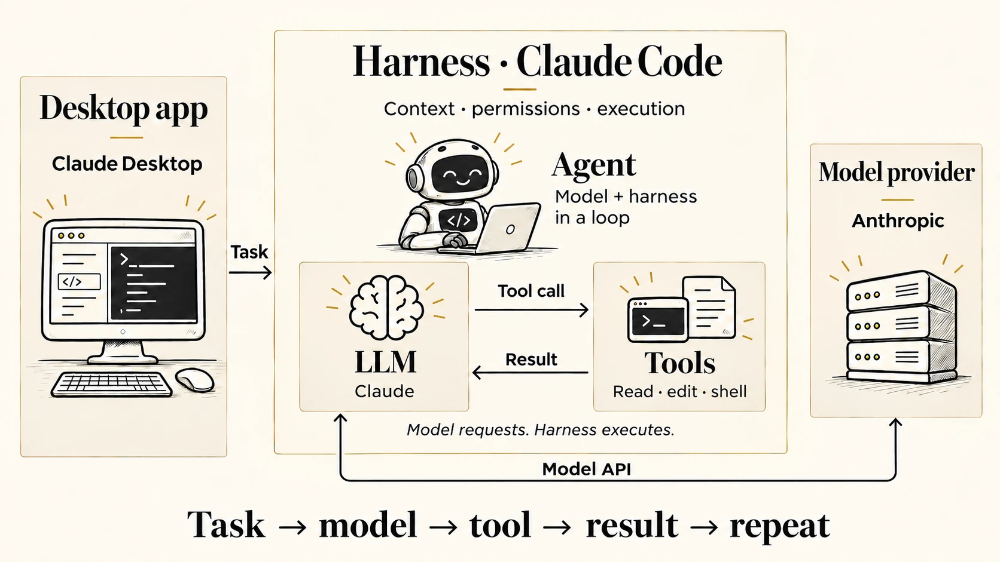{.illustration width="880" height="495" fig-alt="Anthropic example. Claude Desktop's Code tab sends a task to the Claude Code harness, which manages context, permissions, and execution. The agent is a Claude language model working with that harness in a loop. The model requests a tool call; the harness runs read, edit, or shell tools and returns their results to the model. Anthropic provides the model through its API. The diagram shows responsibilities, not where processes run."}

::: {.source}
[Claude Code architecture](https://code.claude.com/docs/en/how-claude-code-works) · [Desktop interface](https://code.claude.com/docs/en/desktop)
:::

### OpenAI

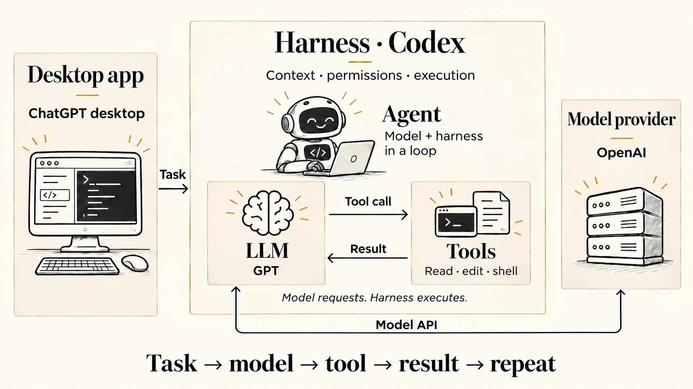{.illustration width="880" height="495" fig-alt="OpenAI example. The ChatGPT desktop app's Codex workspace sends a task to the Codex harness, which manages context, permissions, and execution. The agent is a GPT language model working with that harness in a loop. The model requests a tool call; the harness runs read, edit, or shell tools and returns their results to the model. OpenAI provides the model through its API. The diagram shows responsibilities, not where processes run."}

::: {.source}
[Codex harness](https://developers.openai.com/blog/codex-as-a-platform) · [Desktop interface](https://learn.chatgpt.com/docs/app)
:::

### GitHub Copilot

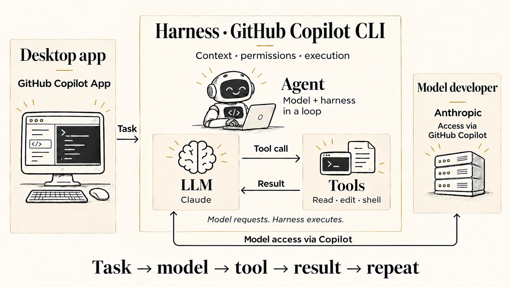{.illustration width="880" height="495" fig-alt="GitHub Copilot example, using a Claude model. VS Code's Copilot interface sends a task to the Copilot harness, which manages context, permissions, and execution. The agent is the selected Claude language model working with the Copilot harness in a loop. The model requests a tool call; the harness runs read, edit, or shell tools and returns their results to the model. Anthropic develops the model; GitHub Copilot provides model access. Selecting Claude does not switch to the Claude Code harness. The diagram shows responsibilities, not where processes run."}

::: {.source}
[Copilot harness and model access](https://code.visualstudio.com/docs/agents/concepts/agent-harnesses) · [Supported models](https://docs.github.com/en/copilot/reference/ai-models/supported-models)
:::

::::

::: {.notes}
Before we discuss the rules, let us agree on the vocabulary. This is a map of responsibilities, rather than a diagram of where software runs. LLM stands for large language model. It reasons over the context it receives and can request an action, but a tool request needs software around the model to carry it out.

That surrounding software is the harness. It manages the conversation, supplies context, applies configured permissions, executes tools, and returns their results to the model. Here, an agent means the working system: a model and its harness pursuing a task through that loop. A tool is a capability such as reading a file, editing code, or running a shell command. Tool-calling is the request-and-result exchange; the model requests, and the harness executes.

In the Anthropic example, the Code tab in Claude Desktop is the interface, Claude Code supplies the harness, Claude is the model family, and Anthropic supplies model access. The desktop app and the model are different parts of the stack.

The OpenAI example keeps those roles: the Codex workspace in the ChatGPT desktop app is the interface, the Codex harness runs the loop, and an OpenAI GPT model supplies the reasoning. Codex is a product and harness name, rather than a synonym for a language model.

The Copilot example uses VS Code as the desktop interface and the Copilot harness. We choose a Claude model to make one distinction visible: Anthropic develops that model, while GitHub Copilot supplies access to it. Choosing Claude in Copilot does not turn the Copilot harness into Claude Code. Other supported models are available, subject to your account and configuration.

Across these examples, the labels change while the responsibilities remain comparable. Keep the model, harness, interface, tools, and model-access service distinct as we work through the rules.
:::

## Golden rules {.smaller}

:::: {.card-grid .card-grid-2 .rule-index}

::: {.card}
[01]{.rule-number}

**Prepare the codebase for agents**
:::

::: {.card}
[02]{.rule-number}

**Improve developer experience**
:::

::: {.card}
[03]{.rule-number}

**Set deterministic quality gates**
:::

::: {.card}
[04]{.rule-number}

**Define done before delegating**
:::

::: {.card}
[05]{.rule-number}

**Maintain session hygiene**
:::

::: {.card}
[06]{.rule-number}

**Know thy tools**
:::

::: {.card}
[07]{.rule-number}

**Automate repeated agent work**
:::

::: {.card}
[08]{.rule-number}

**Identify and remove bottlenecks**
:::

::: {.card}
[09]{.rule-number}

**Be curious. Be humble. Be kind.**
:::

::::

::: {.notes}
The nine rules begin with preparing a codebase for agents, then improve the shared developer and agent experience. They cover defining outcomes, verifying work, managing context, using tools, automating repeated work, relieving delivery bottlenecks, and keeping humans responsible for what ships.
:::

## [01]{.rule-tag} Prepare the codebase for agents {.rule-slide}

[Improve the patterns agents will inherit and repeat.]{.lede}

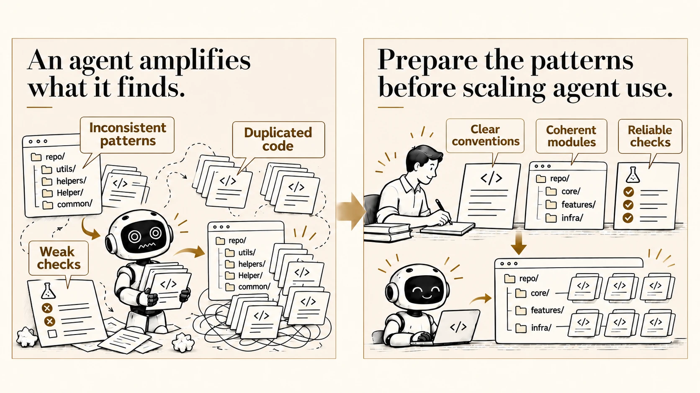{.illustration width="880" height="495" fig-alt="Two-panel illustration: on the left, an agent copies inconsistent naming, duplicated code, and weak checks, multiplying a tangled codebase. On the right, a person prepares clear conventions, coherent modules, and reliable checks before an agent extends the same orderly module pattern."}

::: {.source}
Source: OpenAI, [Harness engineering](https://openai.com/index/harness-engineering/).
:::

::: {.notes}
Before inviting agents into day-to-day work, take stock of the patterns a repository teaches by example. Agents often follow existing structure and conventions. OpenAI describes Codex agents reproducing existing patterns, including uneven or suboptimal ones. If duplication, unclear boundaries, and weak checks are common, generated changes can reinforce those conditions.

Prepare deliberately: pay down high-impact debt, make sound patterns easy to discover, document setup and conventions, and establish checks that surface mistakes. This does not require a codebase-wide rewrite; prioritise issues that block safe, reviewable work.

Once the repository has a sound example to follow, improving developer experience makes those paths and tools easier for agents to use with less context hunting. The next rule connects DevEx to AgentEx.
:::

## [02]{.rule-tag} Improve developer experience {.rule-slide}

[If humans hunt for context, agents burn tokens too.]{.lede}

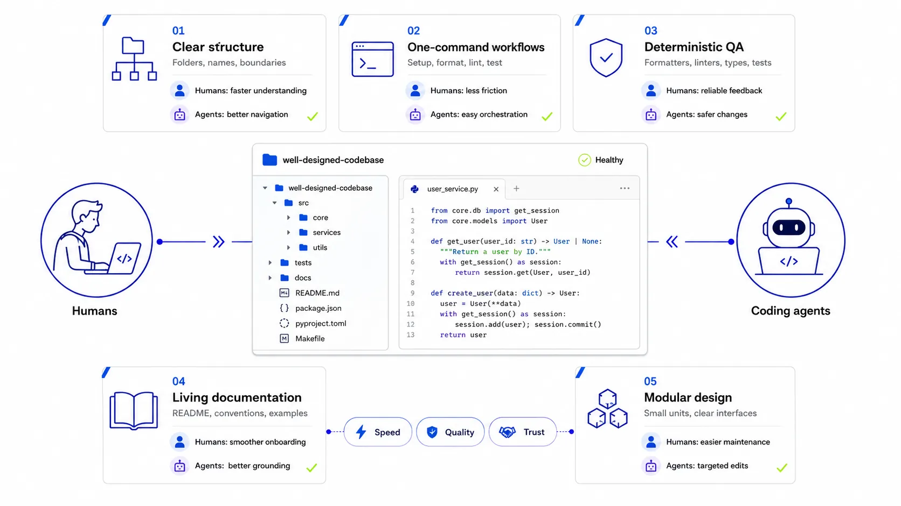{.illustration width="880" height="495" fig-alt="Editorial infographic: a human and a coding agent connect to the same well-designed codebase. Five panels identify clear structure (folders, names, boundaries), one-command workflows (setup, format, lint, test), deterministic QA (formatters, linters, types, tests), living documentation (README, conventions, examples), and modular design (small units, clear interfaces). Shared outcomes are speed, quality, and trust."}

::: {.notes}
DevEx equals AgentEx: what makes a codebase easy for humans makes it cheaper and safer for agents to work in.

If developers need to hunt through unclear documentation, inconsistent commands, or hidden conventions, agents will struggle too. They burn tokens, make assumptions, or ask for more context.
:::

## Improve developer experience: in practice {.rule-slide}

[One setup command. The same starting point for humans and agents.]{.lede}

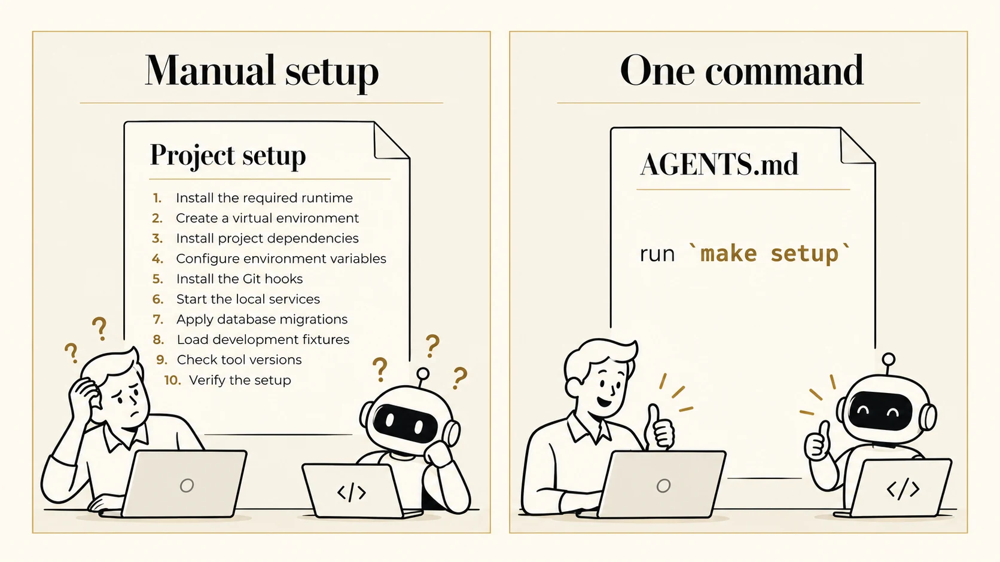{.illustration width="880" height="495" fig-alt="Two-panel illustration: on the left, a detailed ten-step project setup checklist leaves both a human developer and a coding agent confused. On the right, AGENTS.md contains a single instruction, run make setup, and the same human and agent are happy. The command encapsulates the setup procedure behind one shared entry point."}

::: {.source}
See the [AGENTS.md](https://agents.md/) convention.
:::

::: {.notes}
A long setup checklist asks every developer and agent to reconstruct the procedure: install the runtime, create an environment, install dependencies, configure variables, install hooks, start services, apply migrations, load fixtures, and verify the result.

Capture that procedure in a maintained setup command. Then AGENTS.md can point to one starting instruction: run `make setup`. Humans use the same command.

The work still happens; the command owns the sequence, checks prerequisites, and reports useful errors. Keep the implementation reproducible and the instruction current so neither humans nor agents have to guess the next step.
:::

## [03]{.rule-tag} Set deterministic quality gates {.rule-slide}

[Fast feedback beats orchestration.]{.lede}

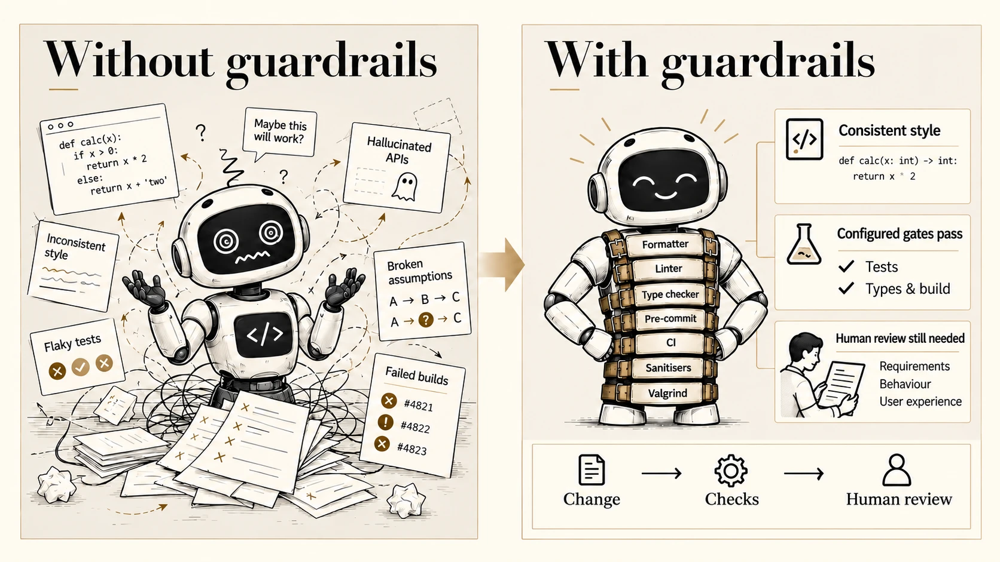{.illustration width="880" height="495" fig-alt="Two-panel illustration contrasting a confused robot amid inconsistent style, flaky tests, broken assumptions, hallucinated APIs, and failed builds with a calm robot in a safety harness labelled Formatter, Linter, Type checker, Pre-commit, CI, Sanitisers, and Valgrind. Output cards show consistent style and configured gates passing for tests, types, and builds. Human review is still needed to assess requirements, behaviour, and user experience. A change flows through checks to human review; passing gates is evidence for review."}

::: {.notes}
Set deterministic quality gates that give agents fast feedback and keep non-determinism under control.
:::

## Set deterministic quality gates: in practice

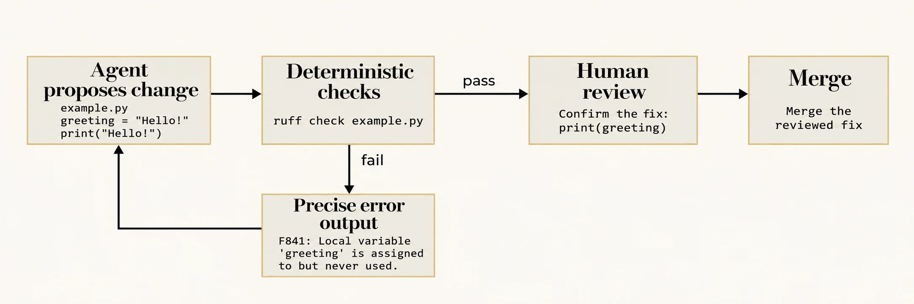{.illustration width="880" height="495" fig-alt="Four-stage Ruff workflow: a coding agent proposes a Python example.py change, Ruff runs `ruff check example.py`, and a pass proceeds to human review and merge. On failure, Ruff reports F841 because greeting is assigned but never used; the error loops back to the agent, which fixes the code by printing greeting."}

::: {.source}
See [Ruff’s F841 rule](https://docs.astral.sh/ruff/rules/unused-variable/).
:::

::: {.notes}
The agent proposes a small Python change. Ruff checks it deterministically and reports F841 when the greeting variable is assigned but never used. The finding loops back to the agent, which fixes the code by printing the variable and reruns the check.

A passing check sends the change to human review before merge. The reviewer checks the intended behaviour and whether the fix makes sense; passing a configured check is evidence, not proof.

Passing a configured check is evidence, not proof that the change meets the requirement. Human review still checks the intended behaviour and whether the fix makes sense.
:::

## [04]{.rule-tag} Define done before delegating {.rule-slide}

[State the outcome, what must stay unchanged, and the evidence that will show it works.]{.lede}

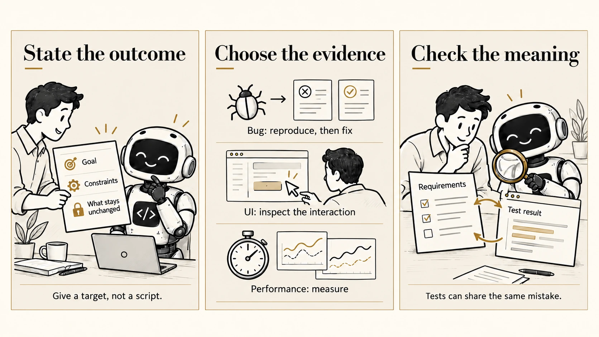{.illustration width="880" height="495" fig-alt="Three-panel illustration: a human gives a robot a brief containing the goal, constraints, and what stays unchanged; evidence is chosen to fit the task, reproducing and fixing a bug, inspecting a UI interaction, or measuring performance; a human and robot compare tests with requirements because both can share the same mistake. Agree the criteria, verify against them, and review the evidence."}

::: {.source}
On specifying success and grading outcomes rather than paths, see [Demystifying evals for AI agents](https://www.anthropic.com/engineering/demystifying-evals-for-ai-agents) (Anthropic).
:::

::: {.notes}
This combines specifying intent with defining done. Before delegating, agree an observable outcome, constraints, what must remain unchanged, and the evidence needed to accept the result. Let the agent choose the route unless the sequence itself matters.

For example: fix date parsing so invalid dates produce the documented error, preserve the public API and valid-date behaviour, and show a reproduction that fails before the fix and passes after it. Check the expected outcome against the requirement, rather than assuming the existing test is right.

Choose evidence that addresses the task. A bug needs a reproduction and a changed outcome. UI work needs inspection of the rendered interaction, including relevant keyboard and responsive states. Performance work needs comparable before-and-after measurements under stated conditions.

When the agent writes both implementation and tests, both can encode the same misunderstanding. Compare the assertions with the agreed criteria, include relevant unchanged behaviour, and inspect the actual result. More tests or higher coverage alone do not settle the question.

Agents must verify their own work: run relevant checks, inspect results, fix failures, and re-check before reporting completion. Hand over evidence tied to the criteria, including any unresolved limitations. Quality gates provide fast feedback; this rule asks whether the evidence proves the intended outcome.

Prescribe steps when their order matters, such as migrations, incident response, or a proven diagnostic workflow. Otherwise, specify the outcome and constraints, provide strong tools, and retain human review of what ships.
:::

## [05]{.rule-tag} Maintain session hygiene {.rule-slide}

[Coherent context beats haunted context.]{.lede}

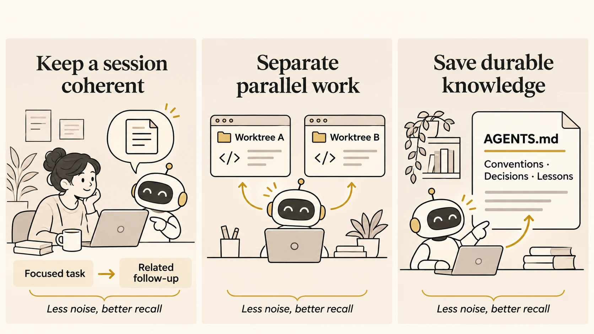{.illustration width="880" height="495" fig-alt="Three-panel illustration: a robot keeps useful context for task A and a related follow-up in the same coherent session, with one task as the default and a reset when confused; parallel tasks A and B run in separate Git worktrees from the same repository; durable conventions, decisions, and lessons move from chat history into AGENTS.md, which a new session consults. A compact handoff contains the goal, constraints, relevant files, ruled-out approaches, and acceptance checks."}

::: {.source}
Sources: [Context engineering](https://www.anthropic.com/engineering/effective-context-engineering-for-ai-agents) and [Claude Code best practices](https://code.claude.com/docs/en/best-practices) (Anthropic) · [Git worktrees](https://git-scm.com/docs/git-worktree).
:::

::: {.notes}
Keep sessions coherent, parallel tasks isolated, and durable knowledge in the repository.

Every correction, abandoned approach, and reversed decision stays in the context window. After enough of them, the agent is reasoning over contradictions.

One task per session is a useful default, not an absolute. A closely related follow-up can benefit from the reasoning and discoveries already in context, and restarting has a cost: a handoff can lose an important constraint or a failed hypothesis. Length matters as well as coherence: Anthropic describes context rot, where recall of information in the context degrades as the token count grows. Clear context between unrelated tasks; compact only when continuing related work whose decisions are worth keeping. Restart when the context stops being coherent or is filling with material the next step does not need.

Use one Git worktree per parallel task so each task has its own working directory. Keep durable conventions, decisions, and lessons in the repository, for example in `AGENTS.md`, so future sessions can find them without relying on old chat history.

Signs of a haunted session include reviving a rejected approach, confusing earlier and current requirements, repeating the same correction, or continuing after the conversation has outgrown its original task. Claude Code's best practices suggest a concrete threshold: after two failed corrections on the same issue, start fresh with a better prompt.

Reset with a compact handoff: the goal in one sentence, constraints on what must not change, relevant files to start with, approaches already ruled out, and acceptance checks that show when the work is done.
:::

## [06]{.rule-tag} Know thy tools {.rule-slide}

[Sometimes the unlock is a hidden tool affordance.]{.lede}

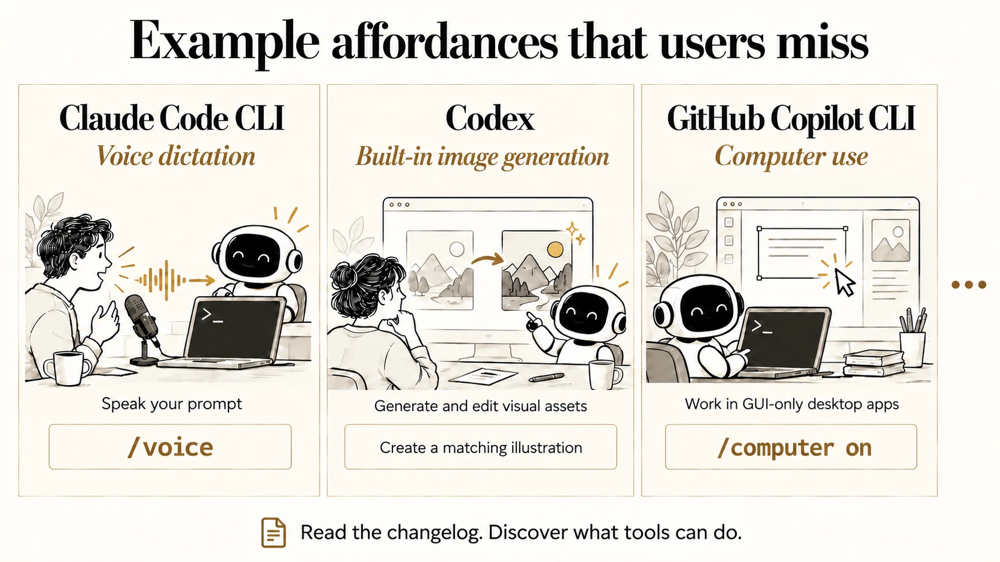{.illustration width="880" height="495" fig-alt="Example affordances that users miss: Claude Code voice dictation turns a spoken prompt into terminal input with /voice; Codex generates and edits visual assets; GitHub Copilot CLI computer use operates GUI-only desktop apps with /computer on. An ellipsis indicates more examples, and the footer encourages reading the changelog to discover what the tools can do."}

::: {.source}
Official docs: [Claude Code voice](https://code.claude.com/docs/en/voice-dictation) · [Codex images](https://learn.chatgpt.com/docs/image-generation) · [Copilot CLI computer use](https://docs.github.com/en/copilot/how-tos/copilot-cli/use-copilot-cli/computer-use).
:::

::: {.notes}
The examples on this slide illustrate capabilities that can be easy to overlook. They reflect official documentation checked in October 2026, so consult the linked documentation for current availability.

Claude Code offers voice input for dictating prompts, with the authentication and environment requirements described on the slide. Codex offers built-in image generation for creating and editing assets alongside the code. GitHub Copilot CLI offers computer use in its supported local environments, subject to permissions and policy. These are different affordances, not claims that one product alone can provide a capability.

Choose the tool interface that fits the task. A direct API or command-line tool is useful when it exposes the operation clearly; computer use can help with a workflow available only through a graphical interface. When results disappoint, examine the context, tools, and feedback available to the agent as well as the model itself.
:::

## [07]{.rule-tag} Automate repeated agent work {.rule-slide}

[Capture recurring workflows once, then run them consistently.]{.lede}

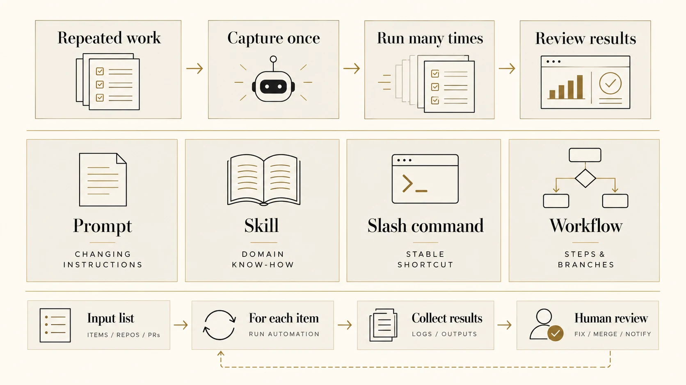{.illustration width="880" height="495" fig-alt="An infographic contrasts repeated work with automation: capture a useful process once, run it across an input list, collect results, then review them. Prompt, skill, slash command, and workflow are shown as distinct ways to package recurring agent work."}

::: {.notes}
When a useful agent workflow repeats, package the instructions or choreography so it can be run consistently. Prompts capture task instructions, skills package reusable know-how, slash commands offer shortcuts, and workflows coordinate steps and branches. These mechanisms can also be composed.
:::

## Automate repeated agent work: in practice {.rule-slide}

[Choose the smallest reusable mechanism that fits the work.]{.lede}

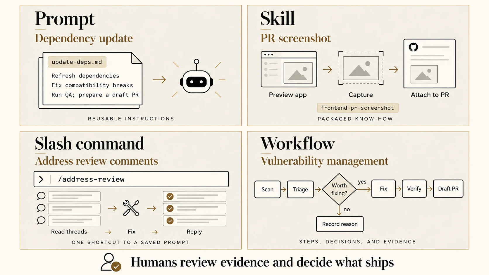{.illustration width="880" height="495" fig-alt="Four examples of packaged automation: a dependency update prompt, a PR screenshot skill, an illustrative review shortcut, and a vulnerability triage workflow. The workflow investigates a finding, fixes and verifies warranted changes, or records why no fix is needed; people review the evidence and decide what ships."}

::: {.notes}
The examples show four ways of packaging repeated work: a prompt for a dependency update, a skill for collecting PR screenshot evidence, a shortcut for reviewing comments, and a workflow for triaging vulnerability findings.

Automate coordination such as gathering context, running checks, and formatting reports. Keep evaluation of evidence, trade-offs, and decisions about what ships with people.
:::

## [08]{.rule-tag} Identify and remove bottlenecks {.rule-slide}

[End-to-end speed is limited by its slowest stage.]{.lede}

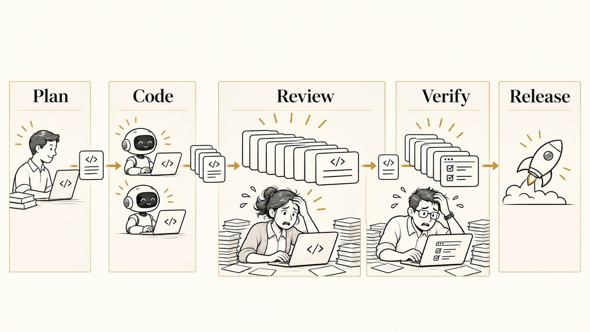{.illustration width="880" height="495" fig-alt="A left-to-right software delivery pipeline shows Plan, Code, Review, Verify, and Release. Coding agents speed up Code and create a large pull-request queue at Review, where a flustered human reviewer is buried in changes. Another queue reaches Verify, where a second flustered human struggles to check behaviour manually."}

::: {.source}
[Amdahl’s law (1967)](https://doi.org/10.1145/1465482.1465560) · [DORA (2025)](https://dora.dev/research/2025/dora-report/).
:::

::: {.notes}
Think about delivery as one connected system: planning, implementation, review, verification, and release. Amdahl’s law describes how the part of a computation that remains unchanged limits the speedup from improving another part. Applied as an analogy to the software lifecycle, faster code production cannot remove delays in review, testing, or release.

The illustration shows coding agents producing changes faster than people can review them, with another human queue at behaviour verification. These bottlenecks can coexist, and relieving one may expose the other. The next slide shows targeted ways to reduce those waits without weakening quality.

The 2025 DORA research describes AI as an amplifier of existing organizational strengths and weaknesses. That supports improving the surrounding delivery system alongside agent capability. After relieving one bottleneck, measure again: constraints move, and the next improvement should follow the new evidence.
:::

## Identify and remove bottlenecks: in practice {.rule-slide}

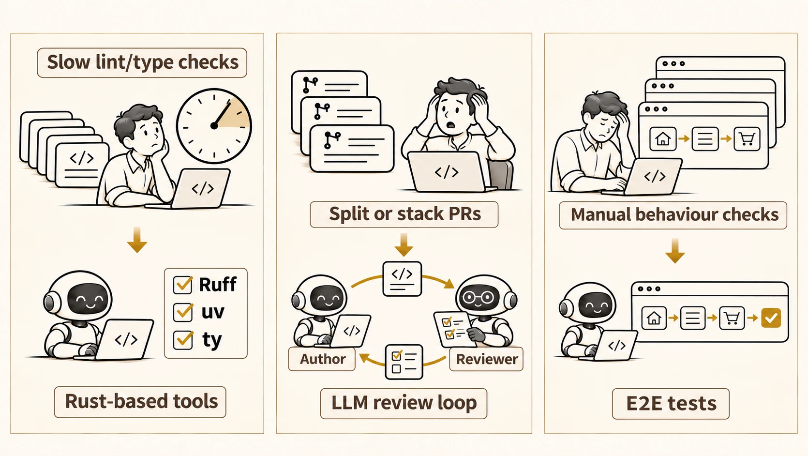{.illustration width="880" height="495" fig-alt="Three bottleneck examples: slow CI waits on a queue, then uses Rust-based tools Ruff, uv, and ty; a large pull request enters an LLM author and reviewer loop; manual behaviour checks become automated E2E tests."}

::: {.source}
Rust-based tools: [Ruff](https://docs.astral.sh/ruff/), [uv](https://docs.astral.sh/uv/), and [ty](https://docs.astral.sh/ty/).
:::

::: {.notes}
Start by finding where work is waiting. In the first example, CI is slow, so the team considers faster Rust-based tools: Ruff for linting and formatting, uv for Python environments and packages, and ty for type checking. Measure the CI workflow before and after to see whether this addresses the delay.

The second example shows a large pull request entering a review loop: an LLM reviewer returns findings to the author, which can revise and request another review. Human reviewers still make the decisions about quality and what ships.

The third example replaces repeated manual checks of a user journey with an end-to-end test. These tests can make important behaviour quicker to check, while exploratory testing remains useful for cases the tests do not cover. These are possible responses, not prescriptions; measure the whole delivery flow again because the bottleneck may move.
:::

## [09]{.rule-tag} Be curious. Be humble. Be kind. {.rule-slide}

[AI is not an excuse to become incompetent or disagreeable.]{.lede}

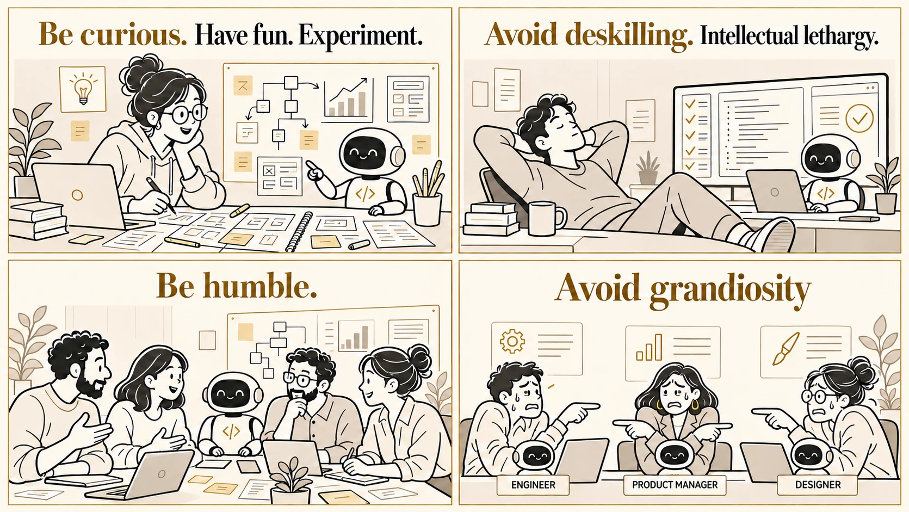{.illustration width="880" height="495" fig-alt="Four-panel editorial illustration: be curious, with a developer experimenting alongside a robot; avoid deskilling, with a disengaged developer leaving the robot unattended; be humble and kind, with a team listening and discussing shared notes; avoid grandiosity, with an engineer, product manager, and designer dismissing one another while pointing to their own assistants."}

::: {.notes}
AI should make us better teammates, not careless or difficult ones.

Be curious about what the tools can do, humble about their limits, and kind in how we review agent-generated work and each other's experiments.
:::

## Be curious. Be humble. Be kind: in practice {.smaller}

:::: {.card-grid .card-grid-3}

::: {.card .card-stone}
[Curious]{.card-title}

Experiment, prototype, and keep learning the fundamentals the agent is standing on.
:::

::: {.card .card-stone}
[Humble]{.card-title}

Agents are confidently wrong. So are we. Verify before you trust, including your own prompt.
:::

::: {.card .card-stone}
[Kind]{.card-title}

Listen generously, offer respectful and actionable feedback, and make room for teammates to learn.
:::

::::

::: {.pull-quote}
[“It’s more fun to be competent”]{.pull-quote-text}

[DHH]{.pull-quote-attribution}
:::

::: {.source}
Quote: DHH, [Opening Keynote, Rails World 2024](https://www.rubyevents.org/talks/opening-keynote-rails-world-2024).
:::

::: {.notes}
Curiosity means trying useful workflows while continuing to understand the underlying system. Humility means checking plausible-looking output and being willing to revise our own assumptions. Kindness is about how we treat one another: listen generously, be respectful when we disagree, and give feedback that helps colleagues learn.

David Heinemeier Hansson puts it simply: “It’s more fun to be competent.” Keep building competence as the tools change: understand the system, verify the work, and stay curious while giving colleagues kind, constructive feedback.
:::

# All for what?

::: {.notes}
Together, these practices can turn a repository into a software factory: routine changes move from a scoped task through implementation, verification, review, and merge with little hands-on intervention.
:::

## A software factory {.smaller}

[Routine requests flow to verified merges; people approve high-stakes work.]{.lede}

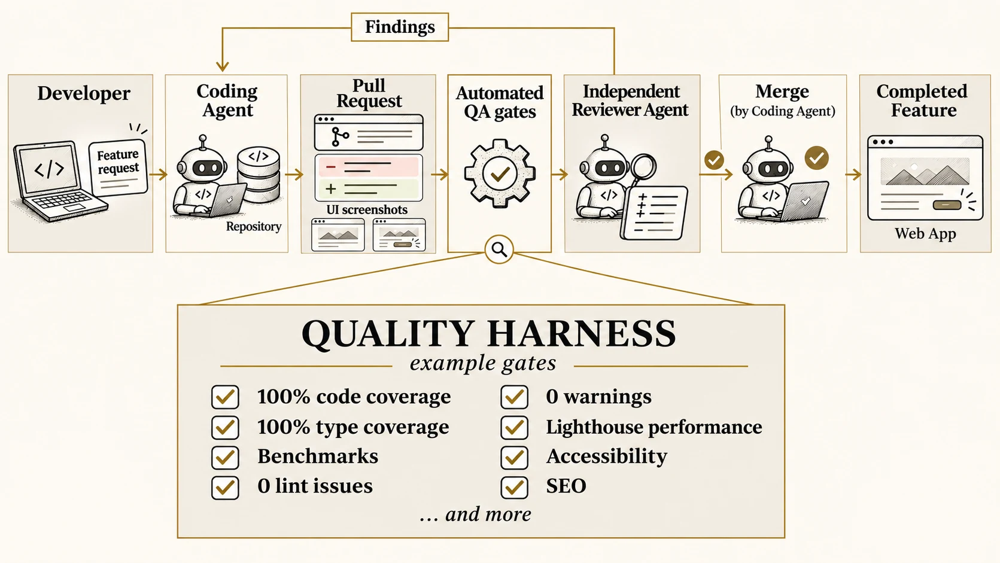{.illustration width="880" height="495" fig-align="center" fig-alt="A feature request moves from a developer to a coding agent, which opens a pull request with UI screenshots. Automated QA gates show example checks for 100% code coverage, 100% type coverage, benchmarks, zero lint issues, zero warnings, Lighthouse performance, accessibility, and SEO. An independent reviewer agent sends findings back to the coding agent; after approval, the coding agent merges and the feature appears in a web app."}

::: {.source}
Example: [chatbot-template](https://github.com/IndrajeetPatil/chatbot-template/).
:::

::: {.notes}
This is what the rules can add up to. Clear repository guidance and simple local commands give agents a reliable starting point; reusable prompts and skills automate repeat work; checks produce evidence at each step. The public chatbot-template repository shows the flow in practice. Locally, `make qa` runs the project quality suite and `make hooks` runs its pre-commit checks. GitHub Actions runs checks for formatting, linting, types, backend and frontend tests, end-to-end browser tests, security, and other quality gates. The main-branch ruleset requires the `prek`, `test`, `backend`, `frontend`, `e2e`, and `qa` status checks. The inset highlights example gates from this strict harness; other projects can select checks that fit their needs.

For frontend changes, the repository's agent instructions require the coding agent to attach screenshots to the pull request. Browser tests also compare visual snapshots, and CodSpeed reports performance regressions. The pull-request workflow asks for a current-head Codex review, sends findings back through a fix-and-review loop, and lets the coding agent squash-merge once Codex gives a thumbs-up and the required checks pass. Codex approval is part of the repository workflow; it is not one of the GitHub ruleset's required status checks.

For bounded, routine changes, this can remove the need for a person to review every pull request. Mission-critical systems can keep human approval at key steps. People still define the tasks and trusted rules, and step in when a change needs judgement or an exception.
:::

# Thank You

Go forth and delegate responsibly.

 

::: {style="text-align: center; font-size: 0.7em;"}

Check out my other [slide decks](https://www.indrapatil.com/presentations/) on software development best practices

:::

::: {style="text-align: center; font-size: 1em;"}

<a class="deck-icon-link" href="https://www.linkedin.com/in/indrajeet-patil-ph-d-397865174/" aria-label="LinkedIn"></a>
&nbsp;&nbsp;
<a class="deck-icon-link" href="https://github.com/IndrajeetPatil" aria-label="GitHub"></a>
&nbsp;&nbsp;
<a class="deck-icon-link" href="mailto:patilindrajeet.science@gmail.com" aria-label="Email"></a>

:::

::: {.notes}
Thank you for your time. Remember to go forth and delegate responsibly.

I am happy to take questions, discuss specific workflows, or hear how your team is navigating agentic engineering.
:::
