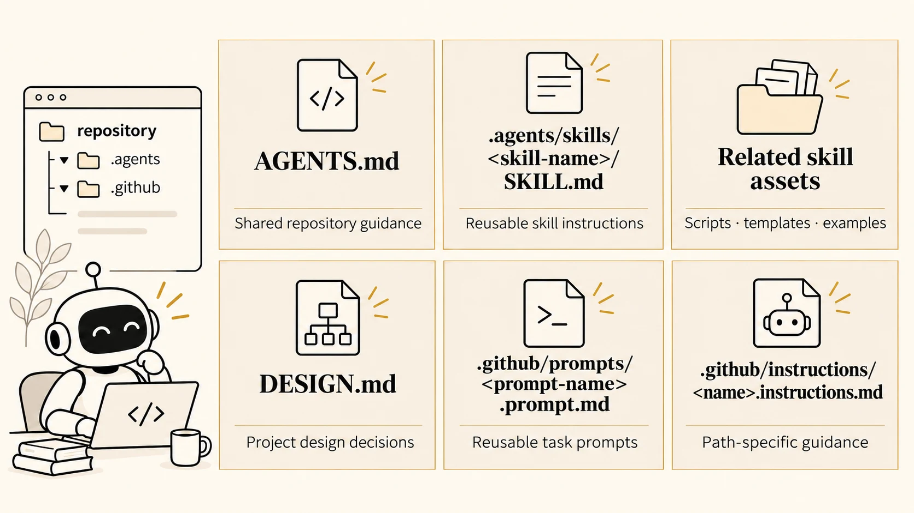
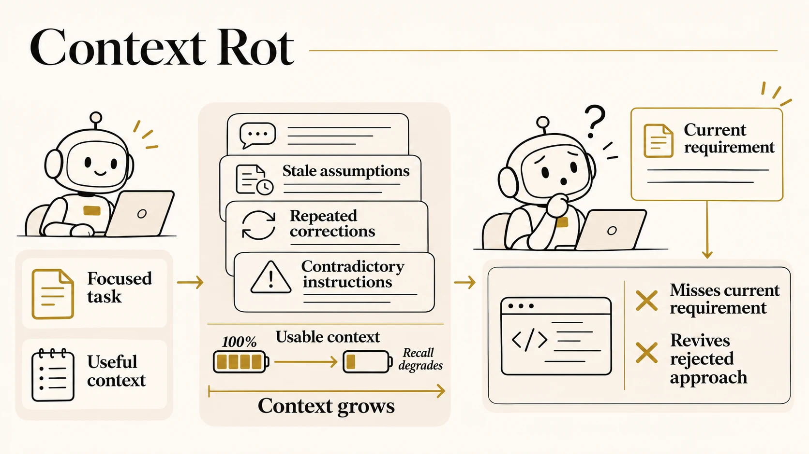
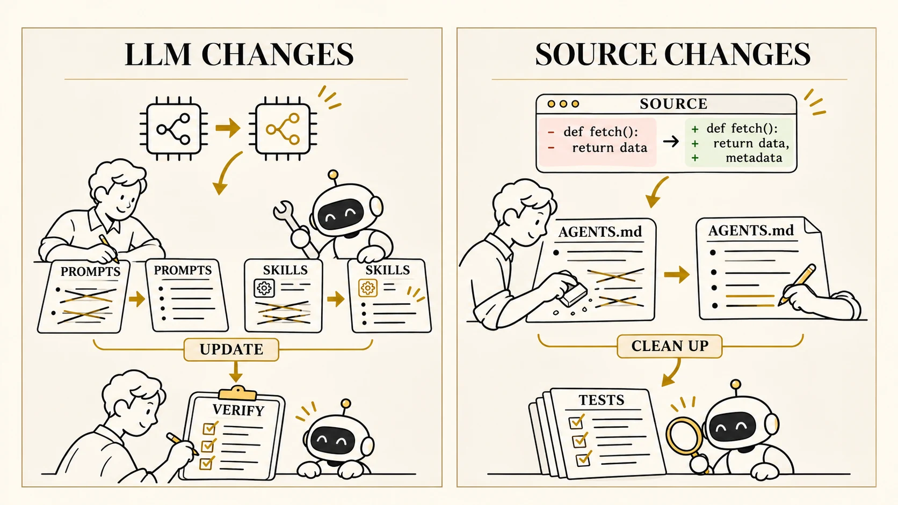
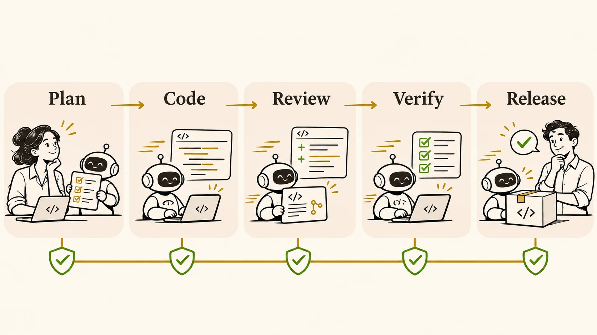

---
format:
  revealjs:
    css: style.css
    theme: simple
    revealjs-plugins:
      - a11y
      - read-aloud
    revealjs-a11y:
      # 0.2.3's menus introduce ARIA failures; retain our slide-menu handling.
      slide-menu-a11y: false
      menu: false
      # Use the extension's core accessibility fixes without extra UI/shortcuts.
      font-size-controls: false
      font-selection: false
      text-spacing: false
      transcript: false
      slide-change-cue: false
    slide-number: true
    code-line-numbers: false
    preview-links: auto
    keyboard: true
    touch: true
    help: true
    include-in-header: meta-tags.html
    include-after-body: accessibility.html
    link-external-newwindow: true
execute:
  echo: true
  eval: false
keywords: ["agentic-engineering", "coding-agents", "software-engineering", "ai-assisted-development"]
description-meta: "Golden rules for agentic engineering: how to use coding agents to boost productivity without compromising quality. Ten rules covering codebase readiness, developer experience, deterministic quality gates, acceptance criteria, context, tools, agent harness maintenance as models and codebases change, automation, delivery bottlenecks, and team culture."
license: "CC0 1.0 Universal"
pagetitle: "Golden Rules for Agentic Engineering"
author-meta: "Indrajeet Patil"
date-meta: "2026-10-08"
lang: "en"
dir: "ltr"
image: "media/social-media-card.webp"
image-alt: "Preview image for a presentation about golden rules for agentic engineering"
canonical-url: "https://www.indrapatil.com/agentic-engineering-golden-rules/"
jupyter: python3
---

## Golden Rules for Agentic Engineering {.title-slide-custom .sr-only-heading}

::: {.hero}

[Indrajeet Patil]{.hero-kicker}

::: {aria-hidden="true"}

[golden rules]{.hero-title}

[for agentic engineering]{.hero-title-italic}

:::

[Boost productivity without compromising quality]{.hero-subtitle}

:::

::: {.hero-source}
Source code for these slides can be found [on GitHub](https://github.com/IndrajeetPatil/agentic-engineering-golden-rules/).
All illustrations in this presentation are AI-generated.
:::

::: {.notes}
This is a practical talk about using coding agents to improve software engineering while protecting quality. The illustrations are AI-generated, reflecting the hands-on subject of the talk.

Think about one part of your daily work where you lose time: finding context, repeating an edit, coordinating changes, or waiting for feedback. Keep that example in mind as we work through the rules.
:::

# Before we start

::: {.notes}
Before we start, let us set expectations for this talk: we are focusing on production software, while recognising that prototypes can call for a lighter process.
:::

## Managing expectations

:::: {.card-grid .card-grid-2}

::: {.card .card-stone}
[Audience]{.eyebrow}

[You ship production software]{.card-title}

Tests, deployment, security, and maintenance matter.
:::

::: {.card .card-ink}
[Caveat]{.eyebrow}

[No panacea]{.card-title}

These rules sharpen judgement; they are not a magic recipe.
:::

::::

::: {.notes}
Engineering rigour depends on the work. Throwaway proofs of concept, demos, and prototypes can defer tests, coverage, and polish; production software needs reliable checks and maintenance. Reassess the work as its purpose changes. The aim is to sharpen judgement, not to sell a magic solution.
:::

## The agentic stack {.rule-slide #agentic-stack}

[Same roles, different products. Follow one task through the loop.]{.lede}

:::: {.panel-tabset .stack-tabs}

### Anthropic

{.illustration width="880" height="495" fig-alt="Anthropic example. Claude Desktop sends a task to the Claude Code CLI harness, which manages context, permissions, and execution. The agent is a Claude language model working with that harness in a loop. The model requests a tool call; the harness runs read, edit, or shell tools and returns their results to the model. Anthropic provides the model through its API. The diagram shows responsibilities, not where processes run."}

::: {.source}
[Claude Code architecture](https://code.claude.com/docs/en/how-claude-code-works) · [Desktop interface](https://code.claude.com/docs/en/desktop)
:::

### OpenAI

{.illustration width="880" height="495" fig-alt="OpenAI example. The ChatGPT desktop app sends a task to the Codex harness, which manages context, permissions, and execution. The agent is a GPT language model working with that harness in a loop. The model requests a tool call; the harness runs read, edit, or shell tools and returns their results to the model. OpenAI provides the model through its API. The diagram shows responsibilities, not where processes run."}

::: {.source}
[Codex harness](https://developers.openai.com/blog/codex-as-a-platform) · [Desktop interface](https://learn.chatgpt.com/docs/app)
:::

### GitHub Copilot

{.illustration width="880" height="495" fig-alt="GitHub Copilot example, using a Claude model. The GitHub Copilot App sends a task to the GitHub Copilot CLI harness, which manages context, permissions, and execution. The agent is the selected Claude language model working with that harness in a loop. The model requests a tool call; the harness runs read, edit, or shell tools and returns their results to the model. Anthropic develops the model; GitHub Copilot provides model access. Selecting Claude does not switch to the Claude Code CLI harness. The diagram shows responsibilities, not where processes run."}

::: {.source}
[GitHub Copilot App](https://docs.github.com/en/copilot/concepts/copilot-surfaces/github-copilot-app) · [Supported models](https://docs.github.com/en/copilot/reference/ai-models/supported-models)
:::

::::

::: {.notes}
Before we discuss the rules, let us agree on the vocabulary. This is a map of responsibilities, rather than a diagram of where software runs. LLM stands for large language model. It reasons over the context it receives and can request an action, but a tool request needs software around the model to carry it out.

That surrounding software is the harness. It manages the conversation, supplies context, applies configured permissions, executes tools, and returns their results to the model. Here, an agent means the working system: a model and its harness pursuing a task through that loop. A tool is a capability such as reading a file, editing code, or running a shell command. Tool-calling is the request-and-result exchange; the model requests, and the harness executes.

In the Anthropic example, the Code tab in Claude Desktop is the interface, Claude Code CLI supplies the harness, Claude is the model family, and Anthropic supplies model access. The desktop app and the model are different parts of the stack.

The OpenAI example keeps those roles: the Codex workspace in the ChatGPT desktop app is the interface, the Codex harness runs the loop, and an OpenAI GPT model supplies the reasoning. Codex is a product and harness name, rather than a synonym for a language model.

The GitHub Copilot App is the desktop interface in this example, and GitHub Copilot CLI provides the harness. We choose a Claude model to make one distinction visible: Anthropic develops that model, while GitHub Copilot supplies access to it. Choosing Claude in Copilot does not turn the Copilot harness into Claude Code CLI. Other supported models are available, subject to your account and configuration.

Across these examples, the labels change while the responsibilities remain comparable. Keep the model, harness, interface, tools, and model-access service distinct as we work through the rules.
:::

## Common artefacts

{.illustration width="840" height="473" fig-alt="Four equal cards in a symmetrical grid show common coding-agent files: AGENTS.md for repository guidance; .agents/skills/<skill-name>/SKILL.md for reusable workflow instructions, with related scripts, references, templates, and assets in the same panel; DESIGN.md for project design decisions; and .github/prompts/<prompt-name>.prompt.md for reusable focused GitHub Copilot tasks."}

::: {.source}
[Codex AGENTS.md](https://developers.openai.com/cookbook/examples/codex/iterating-development-workflows-with-codex) · [Google Labs DESIGN.md](https://github.com/google-labs-code/design.md) · [GitHub prompt files](https://docs.github.com/en/copilot/concepts/prompting-and-context/prompt-files)
:::

::: {.notes}
These four examples are files that can guide coding agents while they work in a codebase. AGENTS.md carries repository instructions. A skill lives under .agents/skills with its own SKILL.md and may keep related scripts, references, templates, and assets beside it. DESIGN.md records project design decisions for agents to follow. GitHub Copilot prompt files use the .prompt.md suffix. These conventions vary by tool; use the files that help agents work in your codebase.
:::

# Golden rules

Ten rules for using coding agents to boost productivity without compromising quality.

::: {.notes}
The next ten rules offer practical ways to use coding agents productively while protecting software quality.
:::

## The rules {.smaller}

:::: {.card-grid .card-grid-2 .rule-index}

::: {.card}
[01]{.rule-number}

**Prepare the codebase for agents**
:::

::: {.card}
[02]{.rule-number}

**Improve developer experience**
:::

::: {.card}
[03]{.rule-number}

**Set deterministic quality gates**
:::

::: {.card}
[04]{.rule-number}

**Define done before delegating**
:::

::: {.card}
[05]{.rule-number}

**Maintain session hygiene**
:::

::: {.card}
[06]{.rule-number}

**Know thy tools**
:::

::: {.card}
[07]{.rule-number}

**Keep pace with a fast-moving field**
:::

::: {.card}
[08]{.rule-number}

**Automate repeated agent work**
:::

::: {.card}
[09]{.rule-number}

**Identify and remove bottlenecks**
:::

::: {.card}
[10]{.rule-number}

**Be curious. Be humble.**
:::

::::

::: {.notes}
The rules begin with preparing a codebase for agents, improving the shared developer and agent experience, and setting deterministic quality gates. They then define outcomes, maintain useful context, use tools well, keep guidance current as models change, automate repeated work, remove delivery bottlenecks, and build a curious and humble team culture.
:::

## [01]{.rule-tag} Prepare the codebase for agents {.rule-slide}

[Improve the patterns agents will inherit and repeat.]{.lede}

{.illustration width="880" height="495" fig-alt="Two-panel illustration: on the left, an agent copies inconsistent naming, duplicated code, and weak checks, multiplying a tangled codebase. On the right, a person prepares clear conventions, coherent modules, and reliable checks before an agent extends the same orderly module pattern."}

::: {.source}
Source: OpenAI, [Harness engineering](https://openai.com/index/harness-engineering/).
:::

::: {.notes}
Before inviting agents into day-to-day work, take stock of the patterns a repository teaches by example. Agents often follow existing structure and conventions. OpenAI describes Codex agents reproducing existing patterns, including uneven or suboptimal ones. If duplication, unclear boundaries, and weak checks are common, generated changes can reinforce those conditions.

Prepare deliberately: pay down high-impact debt, make sound patterns easy to discover, document setup and conventions, and establish checks that surface mistakes. This does not require a codebase-wide rewrite; prioritise issues that block safe, reviewable work.

This foundation leads directly to the next two rules. First, improve developer experience so people and agents can find and follow the repository's sound patterns and workflows. Then make those expectations repeatable with deterministic quality gates and fast feedback.
:::

## [02]{.rule-tag} Improve developer experience {.rule-slide}

[If humans hunt for context, agents burn tokens too.]{.lede}

{.illustration width="880" height="495" fig-alt="Editorial infographic: a human and a coding agent connect to the same well-designed codebase. Five panels identify clear structure (folders, names, boundaries), one-command workflows (setup, format, lint, test), deterministic QA (formatters, linters, types, tests), living documentation (README, conventions, examples), and modular design (small units, clear interfaces). Shared outcomes are speed, quality, and trust."}

::: {.notes}
With a sound codebase in place, DevEx equals AgentEx: what makes the repository easy for humans makes it cheaper and safer for agents to work in.

If developers need to hunt through unclear documentation, inconsistent commands, or hidden conventions, agents will struggle too. They burn tokens, make assumptions, or ask for more context. The next rule makes the quality expectations in those shared workflows repeatable with deterministic checks and fast feedback.
:::

## Improve developer experience: in practice {.rule-slide}

[One setup command. The same starting point for humans and agents.]{.lede}

{.illustration width="880" height="495" fig-alt="Two-panel illustration: on the left, a detailed ten-step project setup checklist leaves both a human developer and a coding agent confused. On the right, AGENTS.md contains a single instruction, run make setup, and the same human and agent are happy. The command encapsulates the setup procedure behind one shared entry point."}

::: {.source}
See the [AGENTS.md](https://agents.md/) convention.
:::

::: {.notes}
A long setup checklist asks every developer and agent to reconstruct the procedure: install the runtime, create an environment, install dependencies, configure variables, install hooks, start services, apply migrations, load fixtures, and verify the result.

Capture that procedure in a maintained setup command. Then AGENTS.md can point to one starting instruction: run `make setup`. Humans use the same command.

The work still happens; the command owns the sequence, checks prerequisites, and reports useful errors. Keep the implementation reproducible and the instruction current so neither humans nor agents have to guess the next step.
:::

## [03]{.rule-tag} Set deterministic quality gates {.rule-slide}

[Let deterministic checks catch what they can, fast.]{.lede}

{.illustration width="880" height="495" fig-alt="Two-panel illustration contrasting a confused robot amid inconsistent style, flaky tests, broken assumptions, hallucinated APIs, and failed builds with a calm robot in a safety harness labelled Formatter, Linter, Type checker, Pre-commit, CI, Sanitisers, and Valgrind. Output cards show consistent style and configured gates passing for tests, types, and builds. Human review is still needed to assess requirements, behaviour, and user experience. A change flows through checks to human review."}

::: {.notes}
With a prepared codebase and clear shared workflows, deterministic checks make repeatable quality expectations concrete. Formatters, linter runs, type checkers, and tests give agents fast feedback and catch known classes of mistakes on every change. They cannot decide whether the work meets an unstated requirement or makes sense for users, so people still review the evidence and the work's impact.
:::

## Quality gates in practice

{.illustration width="880" height="495" fig-alt="Ruff feedback loop: a coding agent defines main() with an unused local greeting variable. Ruff runs `ruff check example.py` and reports F841. The finding points back to the agent, which replaces the assignment with `print(\"Hello!\")` and reruns Ruff. The passing change proceeds to human review and merge."}

::: {.source}
See [Ruff’s F841 rule](https://docs.astral.sh/ruff/rules/unused-variable/).
:::

::: {.notes}
The agent proposes a small Python change. Inside `main()`, it assigns a greeting but never uses it. Ruff reports F841 for that unused local variable. The finding loops back to the agent, which replaces the unused assignment with `print("Hello!")` and reruns the check.

A passing check sends the change to human review before merge. The reviewer checks the intended behaviour and whether the fix makes sense. A configured check is evidence, not proof that a change meets its requirement; automatic checks cannot take responsibility for what ships.
:::

## [04]{.rule-tag} Define done before delegating {.rule-slide}

[Define the outcome and criteria, then have the agent verify its own work.]{.lede}

{.illustration width="880" height="495" fig-alt="Three-panel illustration: a human gives a robot a brief containing the goal, constraints, and what stays unchanged; evidence is chosen to fit the task, reproducing and fixing a bug, inspecting a UI interaction, or measuring performance; a human and robot compare tests with requirements because both can share the same mistake. Agree the criteria, verify against them, and review the evidence."}

::: {.source}
Source: [Anthropic on agent evaluations](https://www.anthropic.com/engineering/demystifying-evals-for-ai-agents).
:::

::: {.notes}
This combines specifying intent with defining done. Before delegating, agree an observable outcome, constraints, what must remain unchanged, and the evidence needed to accept the result. Let the agent choose the route unless the sequence itself matters.

For example: fix date parsing so invalid dates produce the documented error, preserve the public API and valid-date behaviour, and show a reproduction that fails before the fix and passes after it. Check the expected outcome against the requirement, rather than assuming the existing test is right.

Choose evidence that addresses the task. A bug needs a reproduction and a changed outcome. UI work needs inspection of the rendered interaction, including relevant keyboard and responsive states. Performance work needs comparable before-and-after measurements under stated conditions.

When the agent writes both implementation and tests, both can encode the same misunderstanding. Compare the assertions with the agreed criteria, include relevant unchanged behaviour, and inspect the actual result. More tests or higher coverage alone do not settle the question.

Agents must verify their own work: run relevant checks, inspect results, fix failures, and re-check before reporting completion. Hand over evidence tied to the criteria, including any unresolved limitations. Quality gates provide fast feedback; this rule asks whether the evidence proves the intended outcome.

Prescribe steps when their order matters, such as migrations, incident response, or a proven diagnostic workflow. Otherwise, specify the outcome and constraints, provide strong tools, and retain human review of what ships.
:::

## [05]{.rule-tag} Maintain session hygiene {.rule-slide}

[As context grows, recall can degrade and agent output can drift.]{.lede}

{.illustration width="880" height="495" fig-alt="A focused agent begins with a task and useful context. Stale assumptions, repeated corrections, and contradictory instructions accumulate as context grows. A battery gauge for usable context drains from 100% to nearly empty as recall degrades. The confused agent then misses the current requirement and revives a rejected approach."}

::: {.source}
Source: Anthropic, [Effective context engineering for AI agents](https://www.anthropic.com/engineering/effective-context-engineering-for-ai-agents).
:::

::: {.notes}
As the context window grows, an agent may retrieve relevant information less reliably. Stale assumptions, repeated corrections, and contradictory instructions add noise. The output can then miss the current requirement or revive an approach that was already rejected. The battery represents usable context: it drains as unhelpful material crowds the window, and recall degrades.

This degradation is called context rot. It is a reason to manage the information in a session deliberately, rather than treating every earlier message as equally useful.
:::

## Maintain session hygiene in practice

{.illustration width="880" height="495" fig-alt="Three practices keep context useful: a focused task can share coherent notes with a related follow-up; parallel tasks A and B work in separate Git worktrees; durable conventions, decisions, and lessons are saved in AGENTS.md for future sessions. Each panel concludes: less noise, better recall."}

::: {.source}
Sources: [Claude Code best practices](https://code.claude.com/docs/en/best-practices) (Anthropic) · [Git worktrees](https://git-scm.com/docs/git-worktree).
:::

::: {.notes}
Keep a session focused by default, while allowing a closely related follow-up to use context that is still coherent and useful. Separate parallel tasks into Git worktrees so each has its own working directory. Save durable conventions, decisions, and lessons in repository guidance such as `AGENTS.md` so they do not have to be reconstructed from old chat history.

These habits reduce unrelated and contradictory material in the active context, helping the agent retrieve the information that matters to the current task.
:::

## [06]{.rule-tag} Know thy tools {.rule-slide}

[Sometimes the unlock is a hidden tool affordance.]{.lede}

{.illustration width="880" height="495" fig-alt="Example affordances that users miss: Claude Code CLI voice dictation turns a spoken prompt into terminal input with /voice; Codex generates and edits visual assets; GitHub Copilot CLI computer use operates GUI-only desktop apps with /computer on. An ellipsis indicates more examples, and the footer encourages reading the changelog to discover what the tools can do."}

::: {.source}
Official docs: [Claude Code CLI voice](https://code.claude.com/docs/en/voice-dictation) · [Codex images](https://learn.chatgpt.com/docs/image-generation) · [Copilot CLI computer use](https://docs.github.com/en/copilot/how-tos/copilot-cli/use-copilot-cli/computer-use).
:::

::: {.notes}
The examples on this slide illustrate capabilities that can be easy to overlook. They reflect official documentation checked in October 2026, so consult the linked documentation for current availability.

Claude Code CLI offers voice input for dictating prompts, with the authentication and environment requirements described on the slide. Codex offers built-in image generation for creating and editing assets alongside the code. GitHub Copilot CLI offers computer use in its supported local environments, subject to permissions and policy. These are different affordances, not claims that one product alone can provide a capability.

Choose the tool interface that fits the task. A direct API or command-line tool is useful when it exposes the operation clearly; computer use can help with a workflow available only through a graphical interface. When results disappoint, examine the context, tools, and feedback available to the agent as well as the model itself.
:::

## [07]{.rule-tag} Keep pace with a fast-moving field {.rule-slide}

[Keep the agent harness current as models and codebases change.]{.lede}

{.illustration width="880" height="313" fig-alt="Three framed panels show how instructions can shrink as tools change. LLM Changes shows a person and robot updating prompts and skills after a model change. Source Changes replaces read, parse, and write steps with helper.process(); a person removes obsolete AGENTS.md instructions. CLI Changes replaces tool plan, tool build, and tool deploy with one tool ship command; a person shortens a SKILL.md checklist to that command. Both updated instruction sheets contain fewer steps."}

::: {.source}
Source: Anthropic, [Model deprecations](https://docs.anthropic.com/en/docs/about-claude/model-deprecations).
:::

::: {.notes}
The field moves quickly, and the agent harness needs maintenance too. When models, source code, or command-line tools change, look for a simpler way to complete the task. A source change may add a helper that replaces several operations; a CLI may combine a sequence of commands into one. Update `AGENTS.md` and `SKILL.md` to remove superseded steps and keep the useful guidance concise. This makes skills easier to maintain as the tools change.

The examples show two forms of simplification: a source helper replacing read, parse, and write steps, and a single CLI command replacing a three-command sequence. The goal is to keep agent instructions short and current, not to preserve procedural detail after the tools make it unnecessary.
:::

## [08]{.rule-tag} Automate repeated agent work {.rule-slide}

[Capture recurring workflows once, then run them consistently.]{.lede}

{.illustration width="880" height="495" fig-alt="An infographic contrasts repeated work with automation: capture a useful process once, run it across an input list, collect results, then review them. Prompt, skill, slash command, and workflow are shown as distinct ways to package recurring agent work."}

::: {.notes}
When a useful agent workflow repeats, package the instructions or choreography so it can be run consistently. Prompts capture task instructions, skills package reusable know-how, slash commands offer shortcuts, and workflows coordinate steps and branches. These mechanisms can also be composed.
:::

## Automate repeated agent work: in practice {.rule-slide}

[Choose the smallest reusable mechanism that fits the work.]{.lede}

{.illustration width="880" height="495" fig-alt="Four examples of packaged automation: a dependency update prompt, a PR screenshot skill, an illustrative review shortcut, and a vulnerability triage workflow. The workflow investigates a finding, fixes and verifies warranted changes, or records why no fix is needed."}

::: {.source}
Examples: [public prompt library](https://github.com/IndrajeetPatil/chatbot-template/tree/main/.github/prompts) · [PR screenshot skill](https://github.com/IndrajeetPatil/chatbot-template/blob/main/.agents/skills/frontend-pr-screenshot/SKILL.md).
:::

::: {.notes}
The dependency-update prompt, review shortcut, and vulnerability-triage workflow are adapted from the public prompt library. The screenshot example follows its PR screenshot skill. The review shortcut is illustrative; this deck does not install it. The vulnerability example shows a generic triage decision: investigate a finding, fix and verify it when warranted, or record why no fix is needed.

Automate coordination such as gathering context, running checks, and formatting reports. People define the policy for any automated merge: only changes that meet explicit, low-risk criteria qualify. Human review remains the route for ambiguous, risky, or exceptional changes, and people remain accountable for the policy and its results.
:::

## [09]{.rule-tag} Identify and remove bottlenecks {.rule-slide}

[Speeding up one stage helps only as much as the rest allows.]{.lede}

{.illustration width="880" height="495" fig-alt="A left-to-right software delivery pipeline shows Plan, Code, Review, Verify, and Release. Coding agents speed up Code and create a large pull-request queue at Review, where a flustered human reviewer is buried in changes. Another queue reaches Verify, where a second flustered human struggles to check behaviour manually."}

::: {.source}
[Amdahl’s law (1967)](https://doi.org/10.1145/1465482.1465560) · [DORA (2025)](https://dora.dev/research/2025/dora-report/).
:::

::: {.notes}
Think about delivery as one connected system: planning, code, review, verification, and release. Amdahl’s law describes how the part of a computation that remains unchanged limits the speedup from improving another part. Applied as an analogy to software delivery, faster code production cannot remove delays in review, testing, or release.

The illustration shows coding agents producing changes faster than people can review them, with another human queue at behaviour verification. These bottlenecks can coexist, and relieving one may expose the other. The next slide shows targeted ways to reduce those waits without weakening quality.

The 2025 DORA research describes AI as an amplifier of existing organizational strengths and weaknesses. That supports improving the surrounding delivery system alongside agent capability. After relieving one bottleneck, measure again: constraints move, and the next improvement should follow the new evidence.
:::

## Identify and remove bottlenecks: in practice {.rule-slide}

{.illustration width="880" height="495" fig-alt="Three bottleneck examples: a person waits beside queued changes and a slow clock before using Ruff, uv, and ty; several pull requests pile up as a surprised reviewer reacts, then smaller changes enter an LLM author and reviewer loop; an unhappy person repeats the same manual browser journey before an E2E test automates it."}

::: {.source}
Rust-based tools: [Ruff](https://docs.astral.sh/ruff/), [uv](https://docs.astral.sh/uv/), and [ty](https://docs.astral.sh/ty/).
:::

::: {.notes}
Start by finding where work is waiting. In the first example, lint and type checks are slow, so the team considers Ruff for linting and formatting, uv for Python environments and packages, and ty for type checking. These tools target those checks; they do not make a slow test suite or build faster. Caching or parallelising work may suit other bottlenecks. Measure the affected step and the full workflow before and after.

The second example starts by splitting or stacking a large pull request into smaller, reviewable changes. An LLM reviewer can then return findings to the author in a loop. Human reviewers still judge quality and decide what ships, except where the team has explicitly authorised automatic merging for a bounded, low-risk class of change.

The third example replaces repeated manual checks of a user journey with an end-to-end test. These tests can make important behaviour quicker to check, while exploratory testing remains useful for cases the tests do not cover. These are possible responses, not prescriptions; measure the whole delivery flow again because the bottleneck may move.
:::

## [10]{.rule-tag} Be curious. Be humble. {.rule-slide}

[AI is not an excuse to become incompetent or disagreeable.]{.lede}

{.illustration width="880" height="495" fig-alt="Four-panel editorial illustration: be curious, with a developer experimenting alongside a robot; avoid deskilling, with a disengaged developer leaving the robot unattended; be humble, with colleagues listening and discussing shared notes; avoid grandiosity, with an engineer, product manager, and designer all pointing fingers at one another in a flustered, nonviolent three-way standoff."}

::: {.source}
Standoff metaphor: Marc Andreessen on [the future of product, design, and engineering roles](https://www.lennysnewsletter.com/p/marc-andreessen-the-real-ai-boom).
:::

::: {.notes}
AI should make us better teammates, not careless or difficult ones.

Be curious about what the tools can do and humble about their limits. Listen to colleagues, verify agent-generated work, and revise your assumptions when the evidence calls for it.
:::

# The Reward

Build a steady flow of verified work, freeing people to focus on direction and judgement.

::: {.notes}
Together, these practices can turn a repository into a software factory. They speed up routine work through planning, coding, review, verification, and release while people set direction and own risk boundaries.
:::

## A software factory {.smaller}

[Routine requests flow to verified merges; people approve high-stakes work.]{.lede}

{.illustration width="880" height="495" fig-align="center" fig-alt="A feature request moves from a developer to a coding agent, which opens a pull request with UI screenshots and a red-and-green code diff. The magnified quality harness lists file naming, backend and configuration formatting, Markdown formatting and linting, backend lint, spelling, workflow lint, link checking, type checking, API schema validation, dependency audit, backend tests, mutation tests, type coverage, frontend QA, and a security scan, followed by an ellipsis. An independent reviewer agent sends findings back to the coding agent; after approval, the coding agent merges and the feature appears in a web app."}

::: {.source}
Example: [chatbot-template](https://github.com/IndrajeetPatil/chatbot-template/) · OpenAI, [sandbox security](https://developers.openai.com/api/docs/guides/agents-api/environments/security) and [prompt injections](https://openai.com/safety/prompt-injections/).
:::

::: {.notes}
This is what the rules can add up to. Clear repository guidance and simple local commands give agents a reliable starting point; reusable prompts and skills automate repeat work; checks produce evidence at each step. The public chatbot-template repository shows the flow in practice. Locally, `make qa` runs the project quality suite and `make hooks` runs its pre-commit checks. The illustration names checks included in `make qa`: file naming; backend, configuration, and Markdown formatting; backend and Markdown lint; spelling; workflow lint; link checks; type checks; API schema validation; dependency audit; backend tests, mutation tests, and type coverage; frontend QA; and security scanning. An ellipsis indicates that the list continues. GitHub Actions also runs end-to-end browser tests and other checks, with required `prek`, `test`, `backend`, `frontend`, `e2e`, and `qa` statuses. These checks provide evidence, not proof that an implementation meets the requirements, so inspect the behaviour too.

For frontend changes, the repository's agent instructions require the coding agent to attach screenshots to the pull request. The image shows a red-and-green code diff alongside those screenshots. Browser tests also compare visual snapshots, and CodSpeed reports performance regressions. The pull-request workflow asks for a current-head Codex review, sends findings back through a fix-and-review loop, and lets the coding agent squash-merge once Codex gives a thumbs-up and the required checks pass. Codex approval is part of the repository workflow; it is not one of the GitHub ruleset's required status checks.

The team that owns the repository sets the risk boundary and the rules that enforce it. Small, reversible changes such as documentation or formatting updates may qualify for an automatic merge when the task is explicit and every required check passes. The coding and reviewer agents do not set that boundary. People own the policy, monitor its results, and review changes with wider impact or uncertainty; mission-critical systems can require human approval at key steps. Sandboxed work, restricted network access, and scoped credentials limit the impact of mistakes. Repository files and issue text can also contain malicious instructions, so treat them as untrusted input and keep control of consequential actions.
:::

# Conclusion

::: {.notes}
The software factory shows how these practices can help routine work move through delivery. The final view brings the flow together, with people setting direction and applying judgement while quality checks carry through each stage.
:::

## Speed up routine delivery work

[People set direction and risk boundaries; agents accelerate routine work.]{.lede}

{.illustration width="880" height="495" fig-alt="Five stages—Plan, Code, Review, Verify, and Release—connect from left to right. Agent robots assist with routine tasks at each stage; a person sets direction at Plan and applies judgement at Release. A continuous gold line with a checked shield under every stage represents a steady quality bar across the lifecycle."}

::: {.notes}
These practices can speed up routine work through Plan, Code, Review, Verify, and Release. Clear tasks, a well-prepared codebase, useful tools, automation, and attention to bottlenecks make that speed useful. Quality gates carry through the lifecycle, so faster work does not have to mean lower standards. People set direction, own the risk boundary, and apply judgement to high-stakes decisions and exceptions.
:::

# Thank You

Go forth and delegate responsibly.

 

::: {style="text-align: center; font-size: 0.7em;"}

Check out my other [slide decks](https://www.indrapatil.com/presentations/) on software development best practices

:::

::: {style="text-align: center; font-size: 1em;"}

<a class="deck-icon-link" href="https://www.linkedin.com/in/indrajeet-patil-ph-d-397865174/" aria-label="LinkedIn"></a>
&nbsp;&nbsp;
<a class="deck-icon-link" href="https://github.com/IndrajeetPatil" aria-label="GitHub"></a>
&nbsp;&nbsp;
<a class="deck-icon-link" href="mailto:patilindrajeet.science@gmail.com" aria-label="Email"></a>

:::

::: {.notes}
Thank you for your time. Remember to go forth and delegate responsibly.

I am happy to take questions, discuss specific workflows, or hear how your team is navigating agentic engineering.
:::
