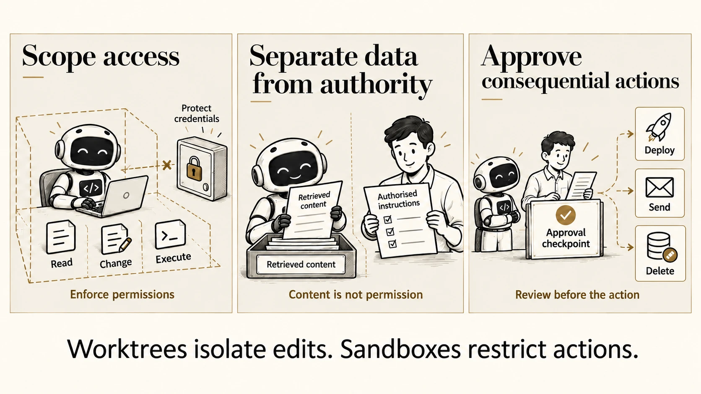

---
format:
  revealjs:
    css: style.css
    theme: simple
    revealjs-plugins:
      - a11y
      - read-aloud
    revealjs-a11y:
      # 0.2.3's menus introduce ARIA failures; retain our slide-menu handling.
      slide-menu-a11y: false
      menu: false
      # Use the extension's core accessibility fixes without extra UI/shortcuts.
      font-size-controls: false
      font-selection: false
      text-spacing: false
      transcript: false
      slide-change-cue: false
    slide-number: true
    code-line-numbers: false
    preview-links: auto
    keyboard: true
    touch: true
    help: true
    include-in-header: meta-tags.html
    include-after-body: accessibility.html
    link-external-newwindow: true
execute:
  echo: true
  eval: false
keywords: ["agentic-engineering", "coding-agents", "software-engineering", "ai-assisted-development"]
description-meta: "Golden rules for agentic engineering: how to use coding agents to boost productivity without compromising quality. Eight rules covering developer experience, guardrails, acceptance criteria, permissions, context, tools, automation, and team culture."
license: "CC0 1.0 Universal"
pagetitle: "Golden Rules for Agentic Engineering"
author-meta: "Indrajeet Patil"
date-meta: "2026-10-08"
lang: "en"
dir: "ltr"
image: "media/social-media-card.webp"
image-alt: "Preview image for a presentation about golden rules for agentic engineering"
canonical-url: "https://www.indrapatil.com/agentic-engineering-golden-rules/"
jupyter: python3
---

## Golden Rules for Agentic Engineering {.title-slide-custom .sr-only-heading}

::: {.hero}

[Indrajeet Patil]{.hero-kicker}

::: {aria-hidden="true"}

[golden rules]{.hero-title}

[for agentic engineering]{.hero-title-italic}

:::

[Boost productivity without compromising quality]{.hero-subtitle}

:::

::: {.hero-source}
Source code for these slides can be found [on GitHub](https://github.com/IndrajeetPatil/agentic-engineering-golden-rules/).
All illustrations in this presentation are AI-generated.
:::

::: {.notes}
This is a practical talk about using coding agents to improve software engineering while protecting quality. The illustrations are AI-generated, reflecting the hands-on subject of the talk.

Think about one part of your daily work where you lose time: finding context, repeating an edit, coordinating changes, or waiting for feedback. Keep that example in mind as we work through the rules.
:::

## Before we start

:::: {.card-grid .card-grid-3}

::: {.card .card-stone}
[Audience]{.eyebrow}

[You ship production software]{.card-title}

Tests, deployment, security, and maintenance matter.
:::

::: {.card .card-outline}
[Exception]{.eyebrow}

[Throwaway code]{.card-title}

Relax engineering rigour for disposable code; retain safeguards for real data and real actions.
:::

::: {.card .card-ink}
[Caveat]{.eyebrow}

[No panacea]{.card-title}

These are principles that sharpen judgement, not a magic recipe.
:::

::::

::: {.source}
On the risks of real actions, see [The lethal trifecta for AI agents](https://simonwillison.net/2025/Jun/16/the-lethal-trifecta/) (Willison) and [Excessive agency](https://genai.owasp.org/llmrisk/llm062025-excessive-agency/) (OWASP).
:::

::: {.notes}
Quality gates such as tests, security, deployment, and maintenance are part of the conversation. Throwaway proofs of concept, demos, and prototypes can trade engineering rigour for speed: tests, coverage, and polish can wait until the code starts to matter, which often happens sooner than planned. The consequences of running the code cannot wait. A disposable script can still expose credentials, alter real data, or send something externally, so keep scoped credentials, sandboxes, and approval before the agreed consequential actions. The aim is to sharpen judgement, not to sell a magic solution.
:::

## The agentic stack {.rule-slide #agentic-stack}

[Same roles, different products. Follow one task through the loop.]{.lede}

:::: {.panel-tabset .stack-tabs}

### Anthropic

{.illustration width="880" height="495" fig-alt="Anthropic example. Claude Desktop's Code tab sends a task to the Claude Code harness, which manages context, permissions, and execution. The agent is a Claude language model working with that harness in a loop. The model requests a tool call; the harness runs read, edit, or shell tools and returns their results to the model. Anthropic provides the model through its API. The diagram shows responsibilities, not where processes run."}

::: {.source}
[Claude Code architecture](https://code.claude.com/docs/en/how-claude-code-works) · [Desktop interface](https://code.claude.com/docs/en/desktop)
:::

### OpenAI

{.illustration width="880" height="495" fig-alt="OpenAI example. The ChatGPT desktop app's Codex workspace sends a task to the Codex harness, which manages context, permissions, and execution. The agent is a GPT language model working with that harness in a loop. The model requests a tool call; the harness runs read, edit, or shell tools and returns their results to the model. OpenAI provides the model through its API. The diagram shows responsibilities, not where processes run."}

::: {.source}
[Codex harness](https://developers.openai.com/blog/codex-as-a-platform) · [Desktop interface](https://learn.chatgpt.com/docs/app)
:::

### GitHub Copilot

{.illustration width="880" height="495" fig-alt="GitHub Copilot example, using a Claude model. VS Code's Copilot interface sends a task to the Copilot harness, which manages context, permissions, and execution. The agent is the selected Claude language model working with the Copilot harness in a loop. The model requests a tool call; the harness runs read, edit, or shell tools and returns their results to the model. Anthropic develops the model; GitHub Copilot provides model access. Selecting Claude does not switch to the Claude Code harness. The diagram shows responsibilities, not where processes run."}

::: {.source}
[Copilot harness and model access](https://code.visualstudio.com/docs/agents/concepts/agent-harnesses) · [Supported models](https://docs.github.com/en/copilot/reference/ai-models/supported-models)
:::

::::

::: {.notes}
Before we discuss the rules, let us agree on the vocabulary. This is a map of responsibilities, rather than a diagram of where software runs. LLM stands for large language model. It reasons over the context it receives and can request an action, but a tool request needs software around the model to carry it out.

That surrounding software is the harness. It manages the conversation, supplies context, applies configured permissions, executes tools, and returns their results to the model. Here, an agent means the working system: a model and its harness pursuing a task through that loop. A tool is a capability such as reading a file, editing code, or running a shell command. Tool-calling is the request-and-result exchange; the model requests, and the harness executes.

In the Anthropic example, the Code tab in Claude Desktop is the interface, Claude Code supplies the harness, Claude is the model family, and Anthropic supplies model access. The desktop app and the model are different parts of the stack.

The OpenAI example keeps those roles: the Codex workspace in the ChatGPT desktop app is the interface, the Codex harness runs the loop, and an OpenAI GPT model supplies the reasoning. Codex is a product and harness name, rather than a synonym for a language model.

The Copilot example uses VS Code as the desktop interface and the Copilot harness. We choose a Claude model to make one distinction visible: Anthropic develops that model, while GitHub Copilot supplies access to it. Choosing Claude in Copilot does not turn the Copilot harness into Claude Code. Other supported models are available, subject to your account and configuration.

Across these examples, the labels change while the responsibilities remain comparable. Keep the model, harness, interface, tools, and model-access service distinct as we work through the rules.
:::

## Golden rules {.smaller}

:::: {.card-grid .card-grid-2 .rule-index}

::: {.card}
[01]{.rule-number}

**DevEx = AgentEx**
:::

::: {.card}
[02]{.rule-number}

**Define done before delegating**
:::

::: {.card}
[03]{.rule-number}

**Bound the blast radius**
:::

::: {.card}
[04]{.rule-number}

**Guardrails**
:::

::: {.card}
[05]{.rule-number}

**Session hygiene**
:::

::: {.card}
[06]{.rule-number}

**Know thy tools**
:::

::: {.card}
[07]{.rule-number}

**Meta-automation**
:::

::: {.card}
[08]{.rule-number}

**Be curious. Be humble. Be kind.**
:::

::::

::: {.notes}
The eight rules cover the engineering lifecycle: choosing whether an agent helps, preparing a usable codebase, defining the result, and checking the work. They also cover context management, tools, repeatable automation, and collaboration. The aim is to connect those practices rather than optimise code generation in isolation.
:::

## [01]{.rule-tag} DevEx = AgentEx {.rule-slide}

[If humans hunt for context, agents burn tokens too.]{.lede}

{.illustration width="880" height="495" fig-alt="Editorial infographic: a human and a coding agent connect to the same well-designed codebase. Five panels identify clear structure (folders, names, boundaries), one-command workflows (setup, format, lint, test), deterministic QA (formatters, linters, types, tests), living documentation (README, conventions, examples), and modular design (small units, clear interfaces). Shared outcomes are speed, quality, and trust."}

::: {.notes}
DevEx equals AgentEx: what makes a codebase easy for humans makes it cheaper and safer for agents to work in.

If developers need to hunt through unclear documentation, inconsistent commands, or hidden conventions, agents will struggle too. They burn tokens, make assumptions, or ask for more context.
:::

## DevEx = AgentEx: in practice {.rule-slide}

[One setup command. The same starting point for humans and agents.]{.lede}

{.illustration width="880" height="495" fig-alt="Two-panel illustration: on the left, a detailed ten-step project setup checklist leaves both a human developer and a coding agent confused. On the right, AGENTS.md contains a single instruction, run make setup, and the same human and agent are happy. The command encapsulates the setup procedure behind one shared entry point."}

::: {.source}
See the [AGENTS.md](https://agents.md/) convention.
:::

::: {.notes}
A long setup checklist asks every developer and agent to reconstruct the procedure: install the runtime, create an environment, install dependencies, configure variables, install hooks, start services, apply migrations, load fixtures, and verify the result.

Capture that procedure in a maintained setup command. Then AGENTS.md can point to one starting instruction: run `make setup`. Humans use the same command.

The work still happens; the command owns the sequence, checks prerequisites, and reports useful errors. Keep the implementation reproducible and the instruction current so neither humans nor agents have to guess the next step.
:::

## [02]{.rule-tag} Define done before delegating {.rule-slide}

[State the outcome, what must stay unchanged, and the evidence that will show it works.]{.lede}

{.illustration width="880" height="495" fig-alt="Three-panel illustration: a human gives a robot a brief containing the goal, constraints, and what stays unchanged; evidence is chosen to fit the task, reproducing and fixing a bug, inspecting a UI interaction, or measuring performance; a human and robot compare tests with requirements because both can share the same mistake. Agree the criteria, verify against them, and review the evidence."}

::: {.source}
On specifying success and grading outcomes rather than paths, see [Demystifying evals for AI agents](https://www.anthropic.com/engineering/demystifying-evals-for-ai-agents) (Anthropic).
:::

::: {.notes}
This combines specifying intent with defining done. Before delegating, agree an observable outcome, constraints, what must remain unchanged, and the evidence needed to accept the result. Let the agent choose the route unless the sequence itself matters.

For example: fix date parsing so invalid dates produce the documented error, preserve the public API and valid-date behaviour, and show a reproduction that fails before the fix and passes after it. Check the expected outcome against the requirement, rather than assuming the existing test is right.

Choose evidence that addresses the task. A bug needs a reproduction and a changed outcome. UI work needs inspection of the rendered interaction, including relevant keyboard and responsive states. Performance work needs comparable before-and-after measurements under stated conditions.

When the agent writes both implementation and tests, both can encode the same misunderstanding. Compare the assertions with the agreed criteria, include relevant unchanged behaviour, and inspect the actual result. More tests or higher coverage alone do not settle the question.

Agents must verify their own work: run relevant checks, inspect results, fix failures, and re-check before reporting completion. Hand over evidence tied to the criteria, including any unresolved limitations. Guardrails provide fast feedback; this rule asks whether the evidence proves the intended outcome.

Prescribe steps when their order matters, such as migrations, incident response, or a proven diagnostic workflow. Otherwise, specify the outcome and constraints, provide strong tools, and retain human review of what ships.
:::

## Define done before delegating: in practice {.smaller}

:::: {.card-grid .card-grid-3}

::: {.card .card-stone}
[Bug fix]{.eyebrow}

Reproduce the failure. Show the same case succeeding after the fix, and check relevant unchanged behaviour.
:::

::: {.card .card-outline}
[UI change]{.eyebrow}

Inspect the rendered interaction, including relevant keyboard and responsive states. A build alone cannot show this.
:::

::: {.card .card-stone}
[Performance]{.eyebrow}

Measure before and after under comparable conditions. State the workload and trade-offs.
:::

::::

::: {.card .card-ink .card-wide}
**Check the meaning of the tests.** Implementation and assertions can agree with each other while missing the requirement.
:::

::: {.source}
Bug and UI checks adapted from [Claude Code best practices](https://code.claude.com/docs/en/best-practices) (Anthropic).
:::

::: {.notes}
Define the expected result before the implementation. Keep the acceptance criteria independent of the agent's chosen solution.

Ask for evidence that a reviewer can inspect: the reproduction and check results for a bug, the rendered interaction for a UI change, and before-and-after measurements for performance work. Check both the requested change and the behaviour that must remain unchanged.

A second agent can offer another perspective, but agreement between agents is not a substitute for checking the requirement and observable outcome.
:::

## [03]{.rule-tag} Bound the blast radius {.rule-slide}

[Limit what the agent can read, change, and execute; agree which actions need approval.]{.lede}

{.illustration width="880" height="495" fig-alt="Three-panel illustration: an agent works within enforced read, change, and execute permissions while credentials are protected; retrieved content stays separate from authorised instructions; a human approval checkpoint precedes deploying, sending, and deleting. Worktrees isolate edits, while sandboxes restrict actions."}

::: {.source}
Sources: [Git worktrees](https://git-scm.com/docs/git-worktree) · OWASP [Excessive agency](https://genai.owasp.org/llmrisk/llm062025-excessive-agency/) · [Prompt injection](https://genai.owasp.org/llmrisk/llm01-prompt-injection/) · Willison [The lethal trifecta](https://simonwillison.net/2025/Jun/16/the-lethal-trifecta/).
:::

::: {.notes}
Review before merge governs the diff, but an agent can read secrets, run commands, or affect external systems before there is a diff to review. Set the operating boundary before it starts.

Define what it may read, change, and execute. Enforce the boundary with appropriate filesystem and network restrictions, limited tool access, and credentials scoped to the task. Keep unnecessary credentials out of its environment and protect secrets from prompts, logs, and generated artefacts. A written instruction alone is not an access control.

Agree which consequential actions require human approval, such as deploying, sending messages, or deleting real data, and enforce that checkpoint before the action. Approval should identify the actual target and effect. Existing explicit authorisation can cover the action; the goal is a clear boundary, not repeated permission questions for routine work.

Retrieved pages, issues, documents, and tool output are evidence to inspect. They do not gain authority to change the task or grant permissions just because the agent reads them. Clearly separate external content from authorised instructions; this reduces risk but does not make prompt injection impossible.

Git documents separate working trees and per-worktree metadata alongside shared repository data. This is separation of edits, not an operating-system access control: worktrees share the host's access and do not provide a security boundary. A sandbox must actually restrict filesystem, process, and network access to contain actions. Check the configured restrictions rather than assuming a tool's default mode supplies them.
:::

## Bound the blast radius: in practice {.smaller}

:::: {.card-grid .card-grid-3}

::: {.card .card-stone}
[Access]{.eyebrow}

Allow only the files, tools, network access, and credentials needed for the task. Enforce the limits outside the prompt.
:::

::: {.card .card-outline}
[Authority]{.eyebrow}

Treat retrieved content as data. It cannot grant permissions or override authorised instructions.
:::

::: {.card .card-stone}
[Approval]{.eyebrow}

Agree the actions that need approval, and place the checkpoint before their real effects.
:::

::::

::: {.card .card-ink .card-wide}
**Worktrees isolate edits; they do not contain actions.** Use a sandbox with enforced access limits.
:::

::: {.source}
Sources: [Git worktrees](https://git-scm.com/docs/git-worktree) · OWASP [Excessive agency](https://genai.owasp.org/llmrisk/llm062025-excessive-agency/) · [Prompt injection](https://genai.owasp.org/llmrisk/llm01-prompt-injection/).
:::

::: {.notes}
Boundaries limit what the agent can affect while it works. Choose the files, tools, commands, and external access the task needs, and keep consequential actions behind the agreed approval checkpoint.

Start by listing necessary reads, writes, commands, and external access. Remove unused tools and credentials. Confirm that the sandbox and downstream systems enforce the agreed limits. Reserve human approval for the agreed consequential actions before they occur.
:::

## [04]{.rule-tag} Guardrails {.rule-slide}

[Fast feedback beats orchestration.]{.lede}

{.illustration width="880" height="495" fig-alt="Two-panel illustration contrasting a confused robot amid inconsistent style, flaky tests, broken assumptions, hallucinated APIs, and failed builds with a calm robot in a safety harness labelled Formatter, Linter, Type checker, Pre-commit, CI, Sanitisers, and Valgrind. Output cards show consistent style and configured gates passing for tests, types, and builds. Human review is still needed to assess requirements, behaviour, and user experience. A change flows through checks to human review; passing gates is evidence for review."}

::: {.notes}
Guardrails are more important than elaborate orchestration. Fast, deterministic feedback keeps the agent's non-determinism under control.
:::

## Guardrails: in practice {.smaller}

::: {.card .card-stone .diagram-card}

{.guardrails-workflow width="960" height="320" fig-alt="Guardrails workflow: the agent proposes a change, then deterministic checks run. On failure, precise error output returns to the agent for another attempt. On success, the change proceeds to human review, then merge."}

:::

:::: {.card-grid .card-grid-3}

::: {.card .card-outline}
[The harness]{.eyebrow}

Formatters, linters, type checkers, behaviour-focused tests, Git hooks, and security scans
:::

::: {.card .card-ink}
[One command]{.eyebrow}

`make qa` checks the agreed gates, and CI runs the **same gates**. Review checks whether we solved the right problem.
:::

::: {.card .card-stone}
[Agents optimise for green]{.eyebrow}

Never weaken a check merely to get there. Repairing a wrong gate is deliberate, reviewed work.
:::

::::

::: {.source}
See also [Harness engineering for coding agent users](https://martinfowler.com/articles/harness-engineering.html) (Böckeler, martinfowler.com).
:::

::: {.notes}
An agent can propose changes quickly, but quality comes from the harness around it: tests, linters, type checks, build commands, security scans, and reproducible local setup.

The workflow sends failed checks back to the agent with precise error output. Passing checks lead to human review before merge.

Green checks establish less than "the work is acceptable". They show that the configured gates pass, not that the requirements were right, that the tests capture them, or that the user experience works. Review answers those questions.

Agents will find the shortest path to green, including lowering a threshold or disabling a check. Do not weaken a check merely to pass. Sometimes a gate really is wrong, such as a flaky test or a rule that does not fit the code; repairing it is legitimate work, but make it a deliberate, separately reviewed change.

Coverage gates invite filler tests. Ask agents to assert behaviour at the boundaries you own (the outbound request, the streamed output, the logged event), never to execute lines for the sake of coverage.
:::

## [05]{.rule-tag} Session hygiene {.rule-slide}

[Coherent context beats haunted context.]{.lede}

{.illustration width="880" height="495" fig-alt="Three-panel illustration: a robot keeps useful context for task A and a related follow-up in the same coherent session, with one task as the default and a reset when confused; parallel tasks A and B run in separate Git worktrees from the same repository; durable conventions, decisions, and lessons move from chat history into AGENTS.md, which a new session consults. A compact handoff contains the goal, constraints, relevant files, ruled-out approaches, and acceptance checks."}

::: {.source}
Sources: [Context engineering](https://www.anthropic.com/engineering/effective-context-engineering-for-ai-agents) and [Claude Code best practices](https://code.claude.com/docs/en/best-practices) (Anthropic) · [Git worktrees](https://git-scm.com/docs/git-worktree).
:::

::: {.notes}
Keep sessions coherent, parallel tasks isolated, and durable knowledge in the repository.

Every correction, abandoned approach, and reversed decision stays in the context window. After enough of them, the agent is reasoning over contradictions.

One task per session is a useful default, not an absolute. A closely related follow-up can benefit from the reasoning and discoveries already in context, and restarting has a cost: a handoff can lose an important constraint or a failed hypothesis. Length matters as well as coherence: Anthropic describes context rot, where recall of information in the context degrades as the token count grows. Clear context between unrelated tasks; compact only when continuing related work whose decisions are worth keeping. Restart when the context stops being coherent or is filling with material the next step does not need.

Use one Git worktree per parallel task so each task has its own working directory. Worktrees isolate edits, not permissions; apply the access limits from Bound the blast radius as well. Keep durable conventions, decisions, and lessons in the repository, for example in `AGENTS.md`, so future sessions can find them without relying on old chat history.

Signs of a haunted session include reviving a rejected approach, confusing earlier and current requirements, repeating the same correction, or continuing after the conversation has outgrown its original task. Claude Code's best practices suggest a concrete threshold: after two failed corrections on the same issue, start fresh with a better prompt.

Reset with a compact handoff: the goal in one sentence, constraints on what must not change, relevant files to start with, approaches already ruled out, and acceptance checks that show when the work is done.
:::

## [06]{.rule-tag} Know thy tools {.rule-slide}

[Sometimes the unlock is a hidden tool affordance.]{.lede}

{.illustration width="880" height="495" fig-alt="Example affordances that users miss: Claude Code voice dictation turns a spoken prompt into terminal input with /voice; Codex generates and edits visual assets; GitHub Copilot CLI computer use operates GUI-only desktop apps with /computer on. An ellipsis indicates more examples, and the footer encourages reading the changelog to discover what the tools can do."}

::: {.source}
Official docs: [Claude Code voice](https://code.claude.com/docs/en/voice-dictation) · [Codex images](https://learn.chatgpt.com/docs/image-generation) · [Copilot CLI computer use](https://docs.github.com/en/copilot/how-tos/copilot-cli/use-copilot-cli/computer-use).
:::

::: {.notes}
The examples on this slide illustrate capabilities that can be easy to overlook. They reflect official documentation checked in October 2026, so consult the linked documentation for current availability.

Claude Code offers voice input for dictating prompts, with the authentication and environment requirements described on the slide. Codex offers built-in image generation for creating and editing assets alongside the code. GitHub Copilot CLI offers computer use in its supported local environments, subject to permissions and policy. These are different affordances, not claims that one product alone can provide a capability.

Choose the tool interface that fits the task. A direct API or command-line tool is useful when it exposes the operation clearly; computer use can help with a workflow available only through a graphical interface. When results disappoint, examine the context, tools, and feedback available to the agent as well as the model itself.
:::

## [07]{.rule-tag} Meta-automation {.rule-slide}

[Automate repeated agent choreography.]{.lede}

{.illustration width="880" height="495" fig-alt="Meta-automation infographic: repeated work is captured once, run many times, and reviewed. Four mechanisms are compared: a prompt for changing instructions, a skill for domain know-how, a slash command for a stable shortcut, and a workflow for steps and branches. A loop processes an input list, runs automation for each item, collects results, and ends with human review."}

::: {.notes}
Capture once. Run many times.

Once a useful agent workflow repeats, automate the choreography around it.
:::

## Meta-automation: in practice {.rule-slide}

[Prompts, skills, shortcuts, and workflows turn repeated work into reusable automation.]{.lede}

{.illustration width="880" height="495" fig-alt="Four concrete automation examples. Prompt: update-deps.md instructs an agent to refresh dependencies, fix compatibility breaks, run QA, and prepare a draft PR. Skill: frontend-pr-screenshot packages how to preview the app, capture a screenshot, and attach it to a PR. Slash command: an illustrative /address-review shortcut invokes a saved prompt to read review threads, make warranted fixes, and reply. Workflow: vulnerability management goes from scan to triage, then asks whether a finding is worth fixing. Yes leads to fix, verify, and draft PR; no leads to recording the reason. Humans review evidence and decide what ships."}

::: {.source}
Examples adapted from [chatbot-template prompts](https://github.com/IndrajeetPatil/chatbot-template/tree/main/.github/prompts) and its [PR screenshot skill](https://github.com/IndrajeetPatil/chatbot-template/blob/main/.agents/skills/frontend-pr-screenshot/SKILL.md).
:::

::: {.notes}
These are examples of different ways to package automation, not four mutually exclusive systems. A slash command can invoke a prompt or a skill; a workflow can compose both.

The dependency-update prompt in chatbot-template refreshes dependencies, fixes compatibility breaks, runs the project's quality gates, and prepares a draft PR. The screenshot skill packages the steps for previewing the app, capturing its appearance, and attaching evidence to a PR.

The /address-review command is an illustrative shortcut to the repository's address-review.md prompt, not a claim that this checkout installs that slash command. Review comments need evaluation; make warranted fixes, verify them, and reply. Resolve only addressed comments or those confirmed to need no change.

The vulnerability-management workflow is adapted from codex-security.md. Scan findings are claims to investigate. Triage checks reachability, existing mitigations, and regression risk before deciding whether a fix is warranted. Confirmed findings with a focused, safe fix proceed to remediation, verification, and a draft PR. Other findings get a recorded reason; no code changes means no PR. Verification includes checking that the vulnerability is resolved and running relevant regression checks. Failed verification returns to the fix step.

Automate coordination: gathering context, running checks, formatting reports, and repeating the process across repositories. Humans evaluate evidence, make trade-offs, and decide what ships. Run unattended agents only in isolated sandboxes with scoped credentials.
:::

## [08]{.rule-tag} Be curious. Be humble. Be kind. {.rule-slide}

[AI is not an excuse to become incompetent or disagreeable.]{.lede}

{.illustration width="880" height="495" fig-alt="Four-panel editorial illustration: be curious, with a developer experimenting alongside a robot; avoid deskilling, with a disengaged developer leaving the robot unattended; be humble and kind, with a team listening and discussing shared notes; avoid grandiosity, with an engineer, product manager, and designer dismissing one another while pointing to their own assistants."}

::: {.notes}
AI should make us better teammates, not careless or difficult ones.

Be curious about what the tools can do, humble about their limits, and kind in how we review agent-generated work and each other's experiments.
:::

## Be curious. Be humble. Be kind: in practice {.smaller}

:::: {.card-grid .card-grid-3}

::: {.card .card-stone}
[Curious]{.card-title}

Experiment, prototype, and keep learning the fundamentals the agent is standing on.
:::

::: {.card .card-stone}
[Humble]{.card-title}

Agents are confidently wrong. So are we. Verify before you trust, including your own prompt.
:::

::: {.card .card-stone}
[Kind]{.card-title}

Review agent-generated work as carefully as human work, and review humans as kindly as ever.
:::

::::

::: {.card .card-ink .card-wide}
**AI does not remove responsibility.** You still own the design, the code, the tests, the security implications, and the communication with your team.
:::

::: {.notes}
Curiosity means trying useful workflows while continuing to understand the underlying system. Humility means checking plausible-looking output and being willing to revise our own assumptions. Kindness means protecting colleagues from unreviewed changes and giving constructive feedback.

Automation does not remove accountability. The engineer accepting a change still needs to understand the evidence and take responsibility for what reaches production.
:::

# Making it stick

::: {.notes}
Moving from individual practices to embedding these rules into daily team habits, collaboration, and culture.
:::

## Code generation is the easy part {.smaller}

[Everything around it needs planning, especially in teams.]{.lede}

:::: {.card-grid .card-grid-2}

::: {.card .card-stone}
[Share]{.eyebrow}

Pool your team's tips and tricks for agentic coding. Someone has already solved your annoyance.
:::

::: {.card .card-stone}
[Fix pain points]{.eyebrow}

Pick a real pain point (slow tests, unclear setup, flaky workflows). Choose tools and workflows that fit the problem, and keep humans responsible for the result.
:::

::: {.card .card-stone}
[Frontload planning]{.eyebrow}

Task division, coordination, and reviewability matter more when everyone has an agent.
:::

::: {.card .card-stone}
[Challenge your habits]{.eyebrow}

Revisit your workflow as tools change. Keep changes that improve the outcome.
:::

::::

::: {.source}
Simplest-solution principle: [Building effective agents](https://www.anthropic.com/engineering/building-effective-agents) (Anthropic).
:::

::: {.notes}
Generating code is only part of delivering a change. A team must also plan the work, coordinate edits, preserve quality, and make the result reviewable.

Share useful discoveries, address real sources of friction, and divide work into changes that can be understood. Revisit the process as the tools evolve, keeping improvements that help the whole team rather than merely increasing the amount of generated code.
:::

## Further reading {.smaller}

::: {.reading-list}

- Willison, S. [Agentic Engineering Patterns](https://simonwillison.net/guides/agentic-engineering-patterns/).

- Anthropic. [Building effective agents](https://www.anthropic.com/engineering/building-effective-agents).

- Anthropic. [Effective context engineering for AI agents](https://www.anthropic.com/engineering/effective-context-engineering-for-ai-agents).

- Anthropic. [Claude Code best practices](https://code.claude.com/docs/en/best-practices).

- Böckeler, B. [Harness engineering for coding agent users](https://martinfowler.com/articles/harness-engineering.html). martinfowler.com.

- Lopopolo, R. [Harness engineering: leveraging Codex in an agent-first world](https://openai.com/index/harness-engineering/). OpenAI.

- Beck, K. [Augmented coding: beyond the vibes](https://tidyfirst.substack.com/p/augmented-coding-beyond-the-vibes).

- Anthropic. [Demystifying evals for AI agents](https://www.anthropic.com/engineering/demystifying-evals-for-ai-agents).

- OWASP. [Excessive agency](https://genai.owasp.org/llmrisk/llm062025-excessive-agency/) and [Prompt injection](https://genai.owasp.org/llmrisk/llm01-prompt-injection/).

- Git. [git-worktree manual](https://git-scm.com/docs/git-worktree).

- [AGENTS.md](https://agents.md/): a simple, open format for guiding coding agents.

:::

::: {.notes}
These references provide the foundations and deeper explorations for the rules covered in this talk, including prompt and context engineering guides, harness design, evaluation methodologies, and security best practices from Anthropic, Google, OWASP, and practitioners like Simon Willison, Kent Beck, and Martin Fowler.
:::

# Thank You

Go forth and delegate responsibly.

 

::: {style="text-align: center; font-size: 0.7em;"}

Check out my other [slide decks](https://www.indrapatil.com/presentations/) on software development best practices

:::

::: {style="text-align: center; font-size: 1em;"}

<a class="deck-icon-link" href="https://www.linkedin.com/in/indrajeet-patil-ph-d-397865174/" aria-label="LinkedIn"></a>
&nbsp;&nbsp;
<a class="deck-icon-link" href="https://github.com/IndrajeetPatil" aria-label="GitHub"></a>
&nbsp;&nbsp;
<a class="deck-icon-link" href="mailto:patilindrajeet.science@gmail.com" aria-label="Email"></a>

:::

::: {.notes}
Thank you for your time. Remember to go forth and delegate responsibly.

I am happy to take questions, discuss specific workflows, or hear how your team is navigating agentic engineering.
:::
